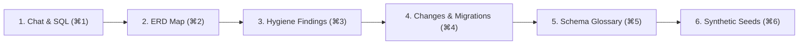

# Dimension — Autonomous Data & Schema Studio

> **An intelligent, local-first database workbench and schema studio. Combines multi-engine connectivity (PostgreSQL, MySQL, SQLite, DuckDB), interactive ERD cartography, automated data hygiene triage, guarded NL-to-SQL execution, shadow-verified migrations, and topological synthetic seed generation.**

Designed with an Obsidian & Carbon frosted-glass aesthetic, Dimension is built for developers, data engineers, and analysts who require deep database intelligence and schema safety without risking production outages or leaking sensitive customer data.

---

## ⚡ The 6 Studio Views

Dimension organizes the engineering workflow into 6 cohesive views accessible via top tabs or global shortcuts:



| View | Shortcut | Purpose & Capabilities |
| :--- | :--- | :--- |
| **`[Chat]`** | `⌘1` | Natural language database assistant with AST safety parsing, pre-flight `EXPLAIN` cost guards, automatic `LIMIT` rewrites, and 1-click execution cards. |
| **`[Map]`** | `⌘2` | Interactive ERD diagram canvas visualizing solid declared foreign keys, dashed machine-inferred semantic relationships, and cross-snapshot schema drift. |
| **`[Findings]`** | `⌘3` | Data hygiene inbox to detect orphan rows, sentinel values (`000-00-0000`, `1900-01-01`), format skew, PII exposure, and unindexed joins with keyboard-driven triage (`J`/`K`/`A`/`D`). |
| **`[Changes]`** | `⌘4` | Verify-before-write migration workbench featuring lock-risk linting, dependency impact checks, two-way rollback tests on disposable shadow databases, and Decision D5 production export guardrails. |
| **`[Glossary]`** | `⌘5` | Semantic schema memory repository. Confirms business definitions, enum maps, and filter rules that automatically augment downstream NL→SQL generation. Exportable to dbt `sources.yml`. |
| **`[Seeds]`** | `⌘6` | Topological Kahn's DAG synthetic seed synthesizer with cycle breaking, distribution matching, and Python `Faker` PII replacement ensuring 0% foreign key violations. |

---

## 🛡️ Core Safety Principles

- **🔒 Local-First by Default**: Runs entirely on your workstation via Ollama (`qwen3:4b`, `qwen2.5-coder`). Telemetry is disabled (`LANGCHAIN_TRACING_V2=false`).
- **🔑 OS Credential Isolation**: Passwords never touch disk or git. Credentials are stored securely in your OS keychain (`keyring`) with opaque UUID references.
- **🛡️ Strict Environment Tiers**:
  - `Sandbox`: Disposable local SQLite/DuckDB files (up to 50M rows read).
  - `Dev / Staging`: Shared development databases with mandatory PII masking and typed confirmation prompts.
  - `Prod`: **Decision D5 Protection** — Direct autonomous writes are strictly blocked; changes export as Alembic, Flyway, or raw SQL migration scripts.
- **📜 Tamper-Proof Audit Chain**: Every execution and change is recorded in an append-only, SHA-256 hash-chained audit log with cryptographic verification (`GET /api/v2/connections/{id}/audit`).
- **🛑 AST Safety Choke Point**: Queries pass through `sqlglot` tokenizer inspection, blocking multi-statement attacks, CTE-masked writes, and injecting row limits before issuing cryptographic HMAC `query_tokens`.

---

## 🚀 Quickstart

### 1. Requirements
- **Python**: 3.9, 3.10, 3.11, or 3.12
- **Supported Engines**: PostgreSQL, MySQL, SQLite, DuckDB
- **Local Model Runner (Optional)**: Ollama (`ollama run qwen3:4b`)

### 2. Installation
```bash
# Clone the repository
git clone https://github.com/aagamshah15/agentic-document-qa.git
cd agentic-document-qa

# Create and activate virtual environment
python3 -m venv venv
source venv/bin/activate

# Install dependencies
pip install -r requirements.txt
```

### 3. Start the Server
```bash
uvicorn main:app --reload --port 8001
```

Open [http://localhost:8001](http://localhost:8001) in your browser.

---

## 📚 Technical & User Documentation

Dimension includes comprehensive technical manuals and user guides:

### Core Manuals
- **[Full User Guide](docs/USER_GUIDE.md)**: Comprehensive guide detailing the 6 Studio Views, AST safety choke points, and keyboard shortcuts.
- **[API Reference (v2)](docs/API_REFERENCE.md)**: Full REST and SSE endpoint documentation for connections, snapshots, diffs, graph cartography, findings, proposals, seeds, and agent runs.
- **[Sample Datasets & Evaluation Fixtures Guide](docs/SAMPLE_DATASETS_GUIDE.md)**: Walkthroughs and recipes for `shop_messy.db`, `wide_schema.db`, and `ecommerce.sqlite`.
- **[Architecture & Inter-Agent Contract](docs/ARCHITECTURE_CONTRACT.md)**: Specification for the 13 formal `ToolSpec` definitions, tool risk scoping, and the monotonic SSE streaming agent model.

### Focused User Guides (`docs/user/`)
| Guide | Description |
| :--- | :--- |
| **[01. Getting Started](docs/user/01-getting-started.md)** | Installation, workbench navigation, and global keyboard shortcuts. |
| **[02. Connecting Databases](docs/user/02-connecting-databases.md)** | PostgreSQL, MySQL, SQLite, DuckDB, environment tiers, and privilege grading. |
| **[03. Schema Cartography](docs/user/03-schema-cartography.md)** | ERD navigation, solid vs. dashed edges, confirming relationships, and drift diffing. |
| **[04. Hygiene & Findings](docs/user/04-hygiene-and-findings.md)** | Anomaly detection, keyboard-driven triage (`J`/`K`/`A`/`D`), and dismiss memory. |
| **[05. Guarded SQL](docs/user/05-guarded-sql.md)** | AST safety, LIMIT rewrites, EXPLAIN cost guards, and HMAC query tokens. |
| **[06. Shadow Migrations](docs/user/06-shadow-migrations.md)** | Scratch cloning, two-way rollbacks, lock-risk linter, and Decision D5 prod export. |
| **[07. Synthetic Seeds](docs/user/07-synthetic-seeds.md)** | Topological Kahn's DAG sorting, cycle breaking, and Faker PII replacement. |
| **[08. Privacy & Safety](docs/user/08-privacy-and-safety.md)** | Local-first architecture, keychain vault, cloud disclosure, and hash-chained audit trails. |

---

## 🧪 Testing & Verification

Run the comprehensive test suite (115 tests validating all 7 phases):

```bash
# Run all Phase 0 through Phase 7 test suites
./venv/bin/python -m unittest \
  tests/test_phase0_foundations.py \
  tests/test_phase1_connect_and_map.py \
  tests/test_phase2_profiler_and_infer.py \
  tests/test_phase3_guarded_nl_sql.py \
  tests/test_phase4_shadow_migrations.py \
  tests/test_phase5_seed_generator.py \
  tests/test_phase6_evaluation_harness.py \
  tests/test_phase7_m6_hardening.py \
  tests/test_studio_runs_and_agent.py \
  tests/test_workbench_ui_integration.py \
  tests/test_db_manager.py \
  tests/test_profiler.py \
  tests/test_squad_c_data_agent.py \
  tests/test_e2e_data_studio.py \
  tests/test_mock_datasets_e2e.py \
  tests/test_output_refiner.py
```

### Benchmark Evaluation
Run the automated ground-truth benchmark suite evaluating precision, recall, and safety against planted traps:
```bash
./venv/bin/python experiments/evaluate_studio.py
```

---

## 📄 License

Dimension is open-source software licensed under the [MIT License](LICENSE).
