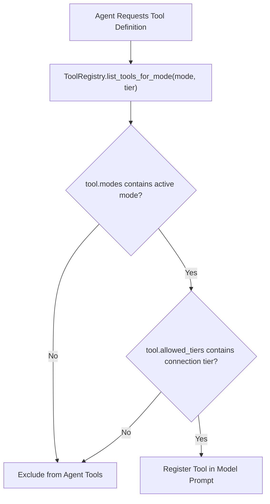
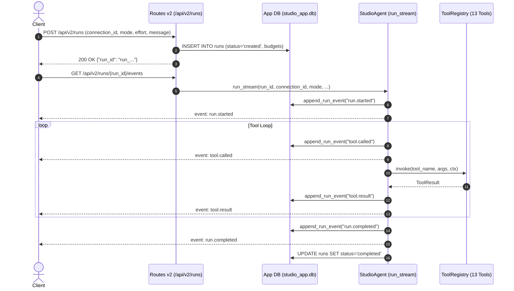

# Dimension — System Architecture & Inter-Agent Contract (v2)

> **Single Source of Truth** for architectural boundaries, tool registries, execution contracts, and agent streaming models across the Dimension Autonomous Data & Schema Studio.

---

## Table of Contents
1. [Architectural Overview & Core Subsystems](#1-architectural-overview--core-subsystems)
2. [Environment Safety Tiers & Decision D5 Contract](#2-environment-safety-tiers--decision-d5-contract)
3. [The 13 Formal `ToolSpec` Registry](#3-the-13-formal-toolspec-registry)
   - [Tool Specifications & Metadata](#tool-specifications--metadata)
   - [Risk Classification & Tier Scoping](#risk-classification--tier-scoping)
   - [Mode & Tier Filtering Matrix](#mode--tier-filtering-matrix)
   - [ToolContext Sandbox & Sanitized Error Contract](#toolcontext-sandbox--sanitized-error-contract)
4. [v2 Studio Agent Run Streaming Model](#4-v2-studio-agent-run-streaming-model)
   - [Run Lifecycle Architecture](#run-lifecycle-architecture)
   - [Monotonic Typed SSE Event Protocol](#monotonic-typed-sse-event-protocol)
   - [Dynamic Multi-Tier Budget Constraints](#dynamic-multi-tier-budget-constraints)
   - [Interruption & Cancellation Semantics](#interruption--cancellation-semantics)
5. [AST Safety Choke Point & Cryptographic Token Contract](#5-ast-safety-choke-point--cryptographic-token-contract)
6. [Cryptographic Hash-Chained Audit Trail Contract](#6-cryptographic-hash-chained-audit-trail-contract)

---

## 1. Architectural Overview & Core Subsystems

Dimension is architected as an autonomous data platform separating the presentation layer from the execution and intelligence subsystems:

```
+-------------------------------------------------------------------------+
|                        Dimension UI (Carbon / Frosted Glass)            |
|       [Chat]      [Map]     [Findings]     [Changes]    [Glossary]     [Seeds]   |
+------------------------------------+------------------------------------+
                                     | HTTP / SSE Stream
                                     v
+-------------------------------------------------------------------------+
|                    FastAPI Backend Core (`/api/v2/*`)                   |
+------------------+--------------------+------------------+--------------+
                   |                    |                  |
                   v                    v                  v
+-----------------------+ +----------------------+ +----------------------+
|  Studio App Database  | |   Connector & Vault  | |    Metadata Catalog  |
|  (`studio_app.db`)    | |  - OS Keyring Vault  | |  - SHA-256 Snapshots |
|  - Connections/Tiers  | |  - Read-Only Sessions| |  - Drift Diff Engine |
|  - Proposals/Audits   | |  - Privilege Grading | |  - Graph ERD Builder |
+-----------------------+ +----------------------+ +----------------------+
                   |                    |                  |
                   +--------------------+------------------+
                                        |
                                        v
+-------------------------------------------------------------------------+
|                     Autonomous Intelligence & Execution                 |
|  +--------------------+  +--------------------+  +-------------------+  |
|  | Tool Registry (13) |  | Studio Agent Runs  |  | AST SQL Guard     |  |
|  | - Mode Filtering   |  | - Monotonic SSE    |  | - LIMIT Rewrites  |  |
|  | - Risk Scoping     |  | - Dynamic Budgets  |  | - HMAC Tokens     |  |
|  +--------------------+  +--------------------+  +-------------------+  |
+-------------------------------------------------------------------------+
```

---

## 2. Environment Safety Tiers & Decision D5 Contract

Every registered database connection is assigned to an immutable safety tier with strict execution invariants:

| Invariant | Sandbox (🟢) | Dev / Staging (🟡) | Prod (🔴) |
| :--- | :--- | :--- | :--- |
| **Max Rows Read per Run** | 50,000,000 | 10,000,000 | 1,000,000 |
| **Execution Time Budget** | 60 seconds | 30 seconds | 15 seconds |
| **PII Masking** | On by default (can disable) | **Locked ON** | **Locked ON** |
| **Direct Migration Apply** | Permitted after shadow test | Requires typed confirmation | **Strictly Forbidden (D5)** |
| **Direct Seed Injection** | Permitted in transaction | Permitted in transaction | **Strictly Forbidden** |

### Decision D5 Contract:
- Autonomous agents or UI users cannot apply schema mutations directly to connections marked `tier: "prod"`.
- Requests to `POST /api/v2/proposals/{prop_id}/apply` for prod connections must fail with HTTP `403 Forbidden`.
- Production changes may only be exported as reviewed migration scripts (Alembic, Flyway, or raw SQL).

---

## 3. The 13 Formal `ToolSpec` Registry

Tools are registered in `services/studio_tools.py` via `ToolSpec` models defined in `services/tool_registry.py`.

### Tool Specifications & Metadata

| # | Tool Name | Description | Risk Level | Allowed Tiers | Modes | Args Model |
| :--- | :--- | :--- | :--- | :--- | :--- | :--- |
| **1** | `search_schema` | Find tables and columns relevant to natural language phrase. | `metadata` | sandbox, dev, prod | explore, ask, change, seed | `SearchSchemaArgs` |
| **2** | `describe_tables` | Retrieve full structural schema for named tables. | `metadata` | sandbox, dev, prod | explore, ask, change, seed | `DescribeTablesArgs` |
| **3** | `get_relationships` | Retrieve declared and inferred relationships up to depth 3. | `metadata` | sandbox, dev, prod | explore, ask, change, seed | `GetRelationshipsArgs` |
| **4** | `infer_foreign_keys` | Run mathematical containment analysis ($\ge 85\%$) to find implicit FKs. | `read_data` | sandbox, dev, prod | explore, change | `InferForeignKeysArgs` |
| **5** | `profile_table` | Compute pushdown statistics, null rates, and PII detection. | `read_data` | sandbox, dev, prod | explore, change | `ProfileTableArgs` |
| **6** | `find_hygiene_issues` | Scan schema for orphans, sentinels, mixed dates, and unindexed FKs. | `read_data` | sandbox, dev, prod | explore, change | `FindHygieneIssuesArgs` |
| **7** | `draft_sql` | AST security guardrails, LIMIT injection, EXPLAIN cost evaluation, HMAC token. | `metadata` | sandbox, dev, prod | ask | `DraftSqlArgs` |
| **8** | `run_query` | Execute validated SQL authorized by query_token in read-only session. | `read_data` | sandbox, dev, prod | ask | `RunQueryArgs` |
| **9** | `propose_migration` | Lock-risk linter and 2-way verification on disposable shadow DB clone. | `write_shadow` | sandbox, dev, prod | change | `ProposeMigrationArgs` |
| **10** | `plan_seed` | Kahn's DAG topological ordering sequence with cycle breaking. | `metadata` | sandbox, dev, prod | seed | `PlanSeedArgs` |
| **11** | `generate_seed` | Generate deterministic synthetic SQL INSERTs with Faker PII replacement. | `write_shadow` | sandbox, dev, prod | seed | `GenerateSeedArgs` |
| **12** | `export_docs` | Export verified schema data dictionary in Markdown or dbt `sources.yml`. | `metadata` | sandbox, dev, prod | explore, ask, change, seed | `ExportDocsArgs` |
| **13** | `propose_glossary_entry` | Propose business definition, enum map, join rule, or caveat rule. | `metadata` | sandbox, dev, prod | explore, ask, change, seed | `ProposeGlossaryEntryArgs` |

---

### Risk Classification & Tier Scoping

Every tool defines a strict risk classification:
- **`metadata`**: Reads only schema catalog tables, snapshots, and glossary memory. Safe across all modes and tiers.
- **`read_data`**: Reads live user data rows under strict tier limits and PII masking policies.
- **`write_shadow`**: Writes exclusively to isolated, disposable shadow database copies. Real database connections are untouched.

### Mode & Tier Filtering Matrix

The agent prompt construction queries the registry via `tool_registry.list_tools_for_mode(mode, tier)`. Tools outside the active mode or restricted by the tier are excluded from the model's tool definitions:



---

### ToolContext Sandbox & Sanitized Error Contract

All tool invocations receive a frozen `ToolContext`:
```python
class ToolContext(BaseModel):
    connection_id: str
    tier: str
    mode: str
    run_id: str
    session_id: str
    budgets: Dict[str, Any]
    app_db: Any
```

#### Sanitized Error Guarantees:
1. Tool execution never throws raw internal exceptions to the LLM agent.
2. Exceptions are caught, sanitized (masking file paths and credentials), and returned as structured `ToolResult(status="error", summary=...)`.
3. If a tool exceeds its assigned row limit or time budget, execution halts immediately with a `BUDGET_EXCEEDED` status code.

---

## 4. v2 Studio Agent Run Streaming Model

Agent runs are managed as stateful entities in `data/studio_app.db` and streamed to clients using Server-Sent Events (SSE).

### Run Lifecycle Architecture



---

### Monotonic Typed SSE Event Protocol

All stream events emitted by `/api/v2/runs/{run_id}/events` follow this strict format:
```http
id: <strictly_incrementing_integer>
event: <event_type>
data: <json_serialized_payload>
```

#### Complete Event Catalogue:

| Event Type | Emitted When | Payload Structure |
| :--- | :--- | :--- |
| **`run.started`** | Run begins execution | `{"run_id": str, "mode": str, "models": dict, "budget": dict}` |
| **`step.started`** | Execution progresses to a new step | `{"step": int, "node": str}` |
| **`tool.called`** | Agent invokes a tool | `{"tool": str, "args": dict}` |
| **`tool.result`** | Tool handler finishes execution | `{"tool": str, "status": str, "summary": str, "duration_ms": float}` |
| **`evidence.added`** | New structural or hygiene fact discovered | `{"kind": str, "table": str, "detail": str}` |
| **`sql.proposed`** | Agent drafts a validated SQL query | `{"sql": str, "query_token": str, "tables": list}` |
| **`sql.executed`** | Authorized SQL executed on read-only session | `{"latency_ms": float, "row_count": int, "columns": list}` |
| **`finding.discovered`**| Hygiene issue detected | `{"finding_id": str, "category": str, "table": str, "detail": str}` |
| **`proposal.created`**| Migration proposal generated | `{"proposal_id": str, "title": str, "status": str}` |
| **`seed.generated`** | Synthetic data batch generated | `{"inserted_statements": int, "tables": list}` |
| **`budget.updated`** | Agent consumes execution budget | `{"used": {"tool_calls": int, "rows_read": int}, "limits": dict}` |
| **`run.completed`** | Run finishes successfully | `{"run_id": str, "status": "completed", "duration_ms": float}` |
| **`run.failed`** | Execution halts due to error or budget | `{"stop_reason": str, "message": str}` |

---

### Dynamic Multi-Tier Budget Constraints

Budgets are dynamically allocated based on reasoning effort and connection safety tier:

```python
budgets = {
    "max_tool_calls": 10 if effort == "low" else 25 if effort == "medium" else 50,
    "max_rows_read": 1_000_000 if tier == "prod" else 10_000_000 if tier == "dev" else 50_000_000,
    "time_budget_sec": 15 if tier == "prod" else 30 if tier == "dev" else 60,
}
```

---

### Interruption & Cancellation Semantics

- **User Cancellation**: Client issues `POST /api/v2/runs/{run_id}/cancel`. The runner updates the database status to `"cancelled"`, setting `stop_reason = "user_cancelled"`.
- **Stream Termination**: The active generator checks `app_db.get_run(run_id)["status"]` before each step. If marked cancelled, the stream yields `run.failed` with `stop_reason="user_cancelled"` and terminates immediately.

---

## 5. AST Safety Choke Point & Cryptographic Token Contract

1. **AST Tokenizer Inspection**: Powered by `sqlglot`. Statements are parsed into Abstract Syntax Trees.
2. **Mutations Blocked**: Statements containing `INSERT`, `UPDATE`, `DELETE`, `DROP`, `ALTER`, `CREATE`, `TRUNCATE`, `GRANT`, `REVOKE`, `COPY`, or `SELECT INTO` raise `SQLGuardException(code="SQL_MUTATION_BLOCKED")`.
3. **Multi-Statement Defense**: Statements with semicolons followed by non-whitespace characters raise `SQLGuardException(code="MULTI_STATEMENT_REJECTED")`.
4. **Mandatory Row Fetch Limits**: `LIMIT 500` is injected if missing; capped at `10,000` maximum.
5. **HMAC Query Token Signature**:
   $$\text{Signature} = \text{HMAC-SHA256}(K, \text{sql} \parallel \text{conn\_id} \parallel \text{tier} \parallel \text{timestamp})$$
   Execution runner verifies signature and checks timestamp ($\le 60\text{ seconds}$).

---

## 6. Cryptographic Hash-Chained Audit Trail Contract

Every system action (queries, proposals, decisions, and apply events) appends to `audit_entries`.

### Hash-Chain Formulation:
$$\text{EntryHash}_i = \text{SHA256}(\text{EntryHash}_{i-1} \parallel \text{Seq}_i \parallel \text{Actor} \parallel \text{Action} \parallel \text{ConnID} \parallel \text{DetailJSON} \parallel \text{Timestamp})$$

### Invariant Verification:
- Genesis entry ($i = 1$) uses `prev_hash = "0000000000000000000000000000000000000000000000000000000000000000"`.
- `GET /api/v2/connections/{conn_id}/audit` recomputes the hash chain across all sequential records.
- Any discrepancy indicates out-of-band record modification or deletion, immediately returning `audit_chain_valid: false`.
