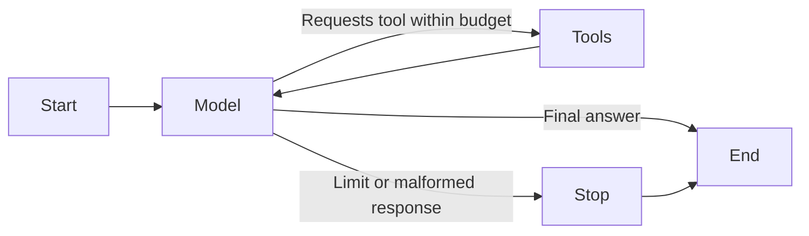

# First document agent: a guided walkthrough

This experiment turns the existing document catalog into a tool that a local
model can choose to call. It runs from the command line, independently of the
existing FastAPI application. The web chatbot still uses its original RAG chain.

## 1. Separate the environments

The original `venv/` uses Python 3.9 and LangChain 0.3. The experiment uses
Python 3.12 in `.venv-agent/`, with its own pinned dependencies. We do not load
the original application's configuration or its `.env` file.

```bash
python3.12 -m venv .venv-agent
.venv-agent/bin/python -m pip install -r requirements-agent.txt
```

`requirements-agent.in` declares direct dependencies and broad compatible
versions; `requirements-agent.txt` records the exact installed versions,
including transitive dependencies, for reproducibility. Re-resolve the input
file deliberately when upgrading, run the tests, and update the pinned file.
The recorded environment was validated on macOS ARM64 with Python 3.12.

Tradeoff: an extra environment and dependency file make setup slightly longer,
but let us investigate agent behavior without breaking the older app's imports.
They are not a permanent plan for deploying two versions of the same application.

## 2. Read the tool wrapper

Start at `services/document_tools.py`, then compare it with
`services/document_catalog.py`.

The catalog performs ordinary filesystem work. The wrapper adds a model-facing
name, a description, an argument schema, and structured error handling.

```text
Model requests: {"name": "list_documents", "args": {}}
Application executes: list_documents()
Tool returns: {"status": "ok", "documents": [...]}
```

The model sees no directory argument. Application code can inject a different
catalog reader for tests, but the model cannot choose that reader. Even though
the catalog supports an optional directory, that is not part of the agent's tool
interface.

This LangChain version skips validation for an empty Pydantic tool schema.
The wrapper therefore supplies a JSON schema and explicitly validates the
arguments before reading the catalog. A regression test checks that an invented
`upload_dir` argument produces an error and does not invoke the reader.

Expected filesystem errors become sanitized tool errors. An empty successful
list remains a successful tool result. Programming errors propagate rather than
being mislabeled as storage failures.

## 3. Observe a manual exchange

The model must first be downloaded into Ollama. See the README for the selected
model and commands. The existing `llama3` model does not advertise native tool
support.

```bash
.venv-agent/bin/python -m experiments.document_agent --mode manual \
  "Which documents have I uploaded?"
```

Read `run_manual_exchange` in `experiments/document_agent.py`. It binds the tool
description to the model, sends the question, executes requested tools, then
sends the results back. This manual demonstration permits just one tool round.
It raises an error if the model requests a second round.

Notice that the tool-result message has the same `tool_call_id` as the request.
That tells the model which result belongs to which request. The application
executes only the registered tool; invented tool names receive errors.

The terminal displays messages and tool calls, so you can distinguish an answer
based on a real inventory from a plausible-sounding answer with no lookup.

## 4. Follow the LangGraph loop

Read `services/document_graph.py`. The main control flow is:



There are three nodes:

- **model** calls the local LLM with the current messages.
- **tools** executes allowed calls and adds their results to those messages.
- **stop** provides an explicit failure response when the agent cannot continue.

The conditional edge after the model selects the next node. The graph manages
execution order; the LLM chooses whether it needs the tool.

State contains the messages, model-call count, tool-request count, and stop
reason. Counters are scoped to one invocation. No checkpointer is configured,
so this graph has no persistent chat memory or crash recovery yet.

Default limits are four model calls and three tool requests. Invalid arguments
and unknown tool names consume the request budget too. A batch cannot exceed
the execution budget: excess requests get error results without executing.
Pending requests are closed with errors when the graph stops at a limit.

The local model configuration also limits generated tokens and configures an
HTTP timeout. That timeout is not a strict end-to-end deadline for the entire
graph. Model/transport failures propagate to the caller instead of silently
retrying. A future web integration should map those to clear API errors and
provide cancellation.

The default Qwen3 model emits a separate thinking stream. The model adapter is
configured to separate that stream from final answer content. We allow 2,048
generated tokens to accommodate both, and do not print the thinking stream in
the CLI or evaluation report. This costs more generation time than a short
non-thinking response. A response stopped by the token limit, or containing
unparsed thinking markers, is treated as a failure rather than a complete answer.

```bash
.venv-agent/bin/python -m experiments.document_agent --mode graph \
  "Which documents have I uploaded?"
```

The CLI prints the final stop reason and counters. `completed` means the model
produced an answer; it does not certify the answer's factual correctness. A
storage failure can be correctly explained in a completed interaction.

## 5. Separate code tests from model evaluations

```bash
# Catalog, wrapper, and graph tests; no Ollama connection required.
.venv-agent/bin/python -m unittest discover -v

# Real local-model evaluation with synthetic temporary files.
.venv-agent/bin/python -m experiments.evaluate_document_agent --mode graph
```

The graph tests use a scripted model but the real graph and wrapper. This lets
us deliberately request unknown tools, repeat calls, return malformed outputs,
and simulate model failures. It tests the orchestration, not model intelligence.

The live evaluation measures the real model on listing, counting, file
existence, a greeting, empty storage, and a storage failure. Its report includes
the full message history, package versions, settings, and checks. Answer checks
are simple heuristics, so the saved transcript still needs review. Passing six
examples is not proof that arbitrary prompts will work.

The experiment and evaluation CLIs disable external tracing even if tracing is
enabled in the shell. Model requests use `http://127.0.0.1:11434` explicitly.
Downloads require the network; inference uses the local Ollama service. The
library functions themselves do not override a caller's tracing configuration.

## Scope boundaries

This milestone discovers saved PDFs. It does not read their contents, establish
indexing readiness, search documents, or persist a conversation. The entire
inventory is returned in one tool result, suitable for a small local library.
Larger libraries will need pagination and a way to search filenames before
results exceed the model's context window.

The next integration decision is how the web app should expose this agent
alongside document Q&A. Migrating the existing RAG chain and adding its retriever
as a second tool should be a separate, tested change.

## What the first evaluations taught us

Llama 3.1 8B produced valid tool calls and accurate inventory answers, but also
called the tool for a greeting, even after the instruction was made clearer.
Qwen3 4B chose the intended actions in the evaluated cases, so it is the default
for this experiment. That is a decision based on these examples, not a general
claim that one model is better for every task.

The first Qwen run also showed why reading transcripts matters. Basic checks
found the expected filenames inside a response, but missed thinking text mixed
into the answer and truncated output. We fixed the model configuration and
added checks that reject those cases. Tool choice, output formatting, and factual
correctness are separate things to evaluate.

The first agent milestone had 55 passing deterministic tests. The real-model suite
contains six scenarios; review its saved answers as well as its automated
checks. Local inventory requests in the successful graph runs took roughly
6–30 seconds with Qwen thinking enabled, while greetings took about 1.5–2
seconds. These are observations from this machine and these runs, not benchmarks.

## References

- [LangGraph's explicit graph quickstart](https://docs.langchain.com/oss/python/langgraph/quickstart)
- [Ollama tool calling](https://docs.ollama.com/capabilities/tool-calling)
- [LangChain's ChatOllama integration](https://docs.langchain.com/oss/python/integrations/chat/ollama)
