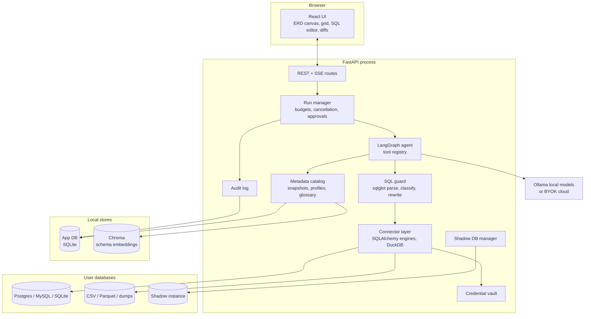

# Architecture

This document describes the components, how data moves between them, and the
choices behind each. The agent's individual tools are specified in
[03-agent-and-tools](03-agent-and-tools.md); the safety rules they obey are in
[04-safety-and-environments](04-safety-and-environments.md).

## Component overview



Every arrow into a user database passes through the **SQL guard** and the
**connector layer**. No tool, and no part of the agent, holds a raw driver
connection. That single choke point is what makes the safety rules
enforceable.

## Process model

For v1 (local-first, decision D1), everything runs in a single FastAPI process
started on the user's machine, as the app is today. Long-running work
(profiling a large table, applying a migration to a shadow) runs as
cancellable `asyncio` tasks owned by the run manager, with blocking driver calls
moved to a thread pool.

| Choice | Reason | Tradeoff |
| --- | --- | --- |
| One process, no job queue | Simple install; the app already works this way. | A crash loses in-flight runs. Runs are recorded as `interrupted` at startup, not resumed. |
| Thread pool for driver calls | SQLAlchemy's sync drivers are the most mature and cover more engines than async ones. | Need explicit statement timeouts; a cancelled task does not stop a running query by itself (see "Cancellation"). |
| Move to a worker queue later | Needed only for a team server (D1 option c). | The run manager's interface should not assume in-process execution, so a queue can be swapped in. |

## Connector layer

### Engines

Use **SQLAlchemy 2.x Core** (not the ORM) for live databases. It gives us a
uniform inspector API for tables, columns, keys, and indexes across engines,
connection pooling, and dialect-aware SQL compilation.

| Engine | Driver | v1? | Notes |
| --- | --- | --- | --- |
| PostgreSQL | `psycopg` (v3) | Yes | Richest metadata: `pg_stats`, `pg_depend`, `EXPLAIN (FORMAT JSON)`, transactional DDL. The best target for shadow verification. |
| SQLite | stdlib `sqlite3` | Yes | Fixtures and demos; limited `ALTER TABLE`. |
| DuckDB | `duckdb` | Yes | Files: CSV, Parquet, JSON, and as a scratch engine for profiling. |
| MySQL / MariaDB | `PyMySQL` or `mysqlclient` | Next | DDL is not transactional, which matters for migration verification. |
| SQL Server, Snowflake, BigQuery | vendor drivers | Later | Each needs its own cost model and permission story. |

### Connection rules

Every connection the Studio opens for the agent is configured, at the session
level, to be as weak as the task allows:

- **Read-only session** for every read tool. In Postgres:
  `SET SESSION CHARACTERISTICS AS TRANSACTION READ ONLY` plus a role that has no
  write grants, when the user can provide one. The setting alone can be undone
  by a statement that changes it, which the guard blocks, but a
  read-only *role* is the stronger control. The connection screen recommends
  creating one and provides the `GRANT` script.
- **Statement timeout** on every session (`statement_timeout` in Postgres,
  `max_execution_time` in MySQL). Default 15 s for agent reads.
- **Lock timeout** (`lock_timeout`) so a read never waits behind a migration on
  someone else's connection.
- **Application name** set to `dimension-studio/<run_id>` so database admins
  can identify, and kill, the Studio's queries.
- **Small pool** (2–4 connections per saved connection). The Studio should never
  be the reason a production database runs out of connections.

### Files and dumps through DuckDB

DuckDB covers three jobs:

1. **Files as databases.** A folder of CSV or Parquet files becomes a
   "connection": each file is a view, and the same catalog, profiling, and
   NL→SQL tools work on it.
2. **SQL dumps.** For a `pg_dump` plain-SQL file, restore it into a shadow
   Postgres when one is available. Otherwise, parse the DDL with sqlglot to
   build the catalog (schema only) and load `COPY` blocks into DuckDB for
   profiling. The tradeoff: DuckDB's type system and functions differ from
   Postgres's, so profiling results on a dump are approximate, and the UI
   labels them as such.
3. **Scratch analytics.** Large profiling samples are pulled once into an
   in-memory DuckDB table, then many statistics are computed locally. This
   moves the work off the user's database, at the cost of transferring a sample.

## SQL guard (sqlglot)

[sqlglot](https://github.com/tobymao/sqlglot) parses SQL from many dialects
into an AST, can transpile between dialects, and can rewrite queries. The
guard uses it for every statement before it reaches a connector.

```text
SQL text from the model or the user
    → parse with the connection's dialect (fail closed: unparseable SQL is rejected)
    → split into statements; reject multi-statement input for read tools
    → classify each statement: READ | WRITE_DML | WRITE_DDL | ADMIN | UNKNOWN
    → check against the tool's and the environment's allowed classes
    → rewrite reads: add or lower LIMIT, add a column cap for SELECT *
    → check referenced tables/columns exist in the catalog snapshot
    → hand the rewritten SQL (not the original) to the connector
```

Key rules:

- **Allow-list, not deny-list.** A read tool accepts only `SELECT`, `WITH ...
  SELECT`, `EXPLAIN`, and `SHOW`/`DESCRIBE` equivalents. Anything else is
  rejected, including statements sqlglot parses as a generic `Command` it does
  not understand.
- **Functions with side effects are blocked by name** inside reads (for
  example, Postgres `pg_sleep`, `dblink`, `lo_import`, `pg_read_file`,
  `set_config`, and `nextval`). This list is a backstop for the read-only
  session and role, not the primary control.
- **Write classification is used for routing, not trust.** A migration
  proposal is classified so the UI can show "this drops a column", and so the
  migration linter can find risky statements. A write still goes through the
  approval flow regardless of what the classifier says.
- **Transpiling** lets the NL→SQL tool generate one dialect and show it in
  another, and lets the seed generator emit inserts for the target engine.

Tradeoff: sqlglot does not support every vendor extension. Some valid queries
will be rejected because they do not parse. That is the right failure
direction. The user can still run such a query by hand in the editor, where the
same read-only session applies, but the agent cannot.

## Metadata catalog

The catalog is the Studio's model of a database. Tools read the catalog rather
than querying `information_schema` each time.

| Layer | Content | Source | Refresh |
| --- | --- | --- | --- |
| Structure | Schemas, tables, views, columns, types, nullability, defaults, PKs, declared FKs, indexes, constraints, view definitions, comments | SQLAlchemy inspector + engine-specific queries | On connect, on demand, and after an applied migration |
| Statistics | Row estimates, table sizes, engine statistics (`pg_stats`: null fraction, distinct count, most common values) | System catalogs; cheap | With structure |
| Profiles | Measured null rates, distinct counts, patterns, ranges, histograms, PII flags | Profiling tool; costs queries | On request; stale-marked when the snapshot changes |
| Inferences | Proposed FKs with scores and evidence, suggested meanings | Agent tools | On request |
| Glossary | Human-confirmed meanings, keys, enums, caveats | User + agent proposals | When a user confirms |

### Snapshots

Every structure refresh produces a **schema snapshot**: a normalized JSON
document of the structure layer, plus a content hash. Snapshots are immutable.

- **Drift detection:** two snapshots with different hashes are compared, and the
  diff is shown ("3 columns added on `orders` since Tuesday").
- **Staleness:** profiles and inferences store the snapshot ID they were computed
  against. When the current snapshot no longer contains their columns, they are
  marked stale rather than silently reused.
- **Environment comparison:** diffing the latest staging snapshot against the
  latest production snapshot is the drift report.
- **Migration base:** a migration proposal records the snapshot it was written
  against. If the live schema has changed since, the proposal must be rebased
  before approval.

Snapshots are stored in the app DB (see 07). A 1,000-table schema is a few
megabytes of JSON. Keep every snapshot for the active connection for 90 days by
default, and keep one per day after that.

## Schema retrieval

A large schema does not fit in a small model's context window. The catalog
therefore keeps a Chroma collection per connection with one document per table.
Each document contains the table name, its columns and types, its comment,
glossary entries, and its relationships. Tools retrieve the relevant tables for
a question, then expand to their join neighbors. Details and budgets are in
[06-models-and-limits](06-models-and-limits.md#context-budgeting-for-schemas).

This reuses the app's existing Chroma and MiniLM setup. MiniLM is a general
English embedding model, and cryptic names like `tbl_cx_ord` embed poorly. That
is one reason the glossary matters: confirmed descriptions are embedded
alongside the names and improve retrieval over time.

## Shadow database

The shadow is a disposable database with the same *schema* as the target and,
optionally, a small sample of its data. It exists so a migration can be applied,
checked, and rolled back without touching anything real.

| Target engine | Shadow strategy | Fidelity |
| --- | --- | --- |
| Postgres | A local Postgres (Docker `postgres:<same major version>` or an existing local server). Restore `pg_dump --schema-only`, then optionally load a sample. | High. DDL is transactional, so apply/rollback can run inside one transaction, plus a separate apply-then-down-migration test. |
| SQLite | Copy the file. | Exact. |
| MySQL | Docker `mysql:<version>` with schema-only dump. | Good, but DDL auto-commits, so the test must explicitly run the down-migration. |
| Files/DuckDB | In-memory DuckDB. | Exact for DuckDB itself. |

Fidelity caveats, shown in the UI next to every shadow result:

- **Volume.** A migration that takes 50 ms on a sampled shadow can take an hour
  on a 500 GB table. The shadow verifies *correctness*; the lock-risk linter (03)
  estimates *cost* from the real table's size.
- **Concurrency.** The shadow has no live traffic, so lock contention never
  appears there.
- **Extensions and versions.** A shadow on a different major version, or
  without the same extensions, can pass where production fails. The shadow
  manager checks `server_version` and installed extensions, and refuses to
  label a mismatched shadow as "verified".

Docker is an optional dependency. Without it, migration verification is limited
to SQLite/DuckDB targets or a user-supplied scratch Postgres URL. The UI states
this clearly instead of pretending to verify.

## Run manager and streaming

A **run** is one agent task: "map this database", "answer this question",
"propose this migration". The run manager:

- Creates a run record with a budget (06) and an environment tier (04).
- Starts the LangGraph invocation and translates its steps into **typed SSE
  events** (full schema in 07): `run.started`, `step.started`, `tool.called`,
  `tool.result`, `evidence.added`, `token`, `approval.required`, `run.completed`,
  `run.failed`.
- Pauses at approval gates. The graph state is checkpointed to the app DB using
  LangGraph's checkpointer, so a run can wait for approval for hours, and a
  reconnecting browser can resume the stream from the last event ID.
- Enforces wall-clock limits and handles cancellation.

The current `/query/stream` endpoint streams raw tokens with ad-hoc JSON. The
Studio needs typed events because the UI shows more than text: tool calls,
evidence cards, plans, and approval prompts all arrive on the same stream.

### Cancellation

Cancelling an `asyncio` task does not stop a query already running on the
database. The run manager therefore records each connector call's backend
process ID, and on cancel issues the engine's cancel (`pg_cancel_backend` from a
separate connection, or the driver's `cancel()`), then marks pending tool calls
as cancelled. Statement timeouts are the backstop when cancellation fails.

## Dependencies to add

| Package | Purpose |
| --- | --- |
| `sqlalchemy>=2` | Connector layer, inspection |
| `psycopg[binary]` | Postgres driver |
| `duckdb` | Files, dumps, scratch profiling |
| `sqlglot` | Parsing, classification, transpiling, rewriting |
| `langgraph-checkpoint-sqlite` | Durable run state across approval pauses |
| `keyring` | OS credential storage (04) |
| `faker` | Seed generation (03) |
| `docker` (optional) | Shadow database lifecycle |

All of them go into `requirements-agent.in` and the pinned file, following the
existing procedure for the agent environment.
