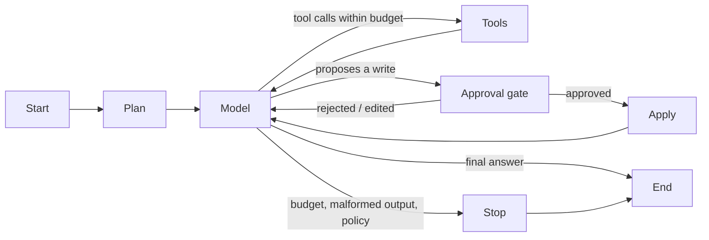

# Agent and tools

This document specifies the agent's loop and the contract for each tool. It
follows the pattern that already works in `services/document_tools.py`: a strict
argument schema, application-chosen scope that the model cannot override, and
sanitized errors that tell the model what happened without leaking internals.

## The agent loop

The Studio generalizes `services/document_graph.py`:



Changes from the document agent:

| Change | Why |
| --- | --- |
| A **tool registry** instead of one tool | Many tools; each declares its risk class and the environments where it is allowed. |
| An optional **plan** node | For multi-step tasks ("document this database"), a cheap model writes a short checklist that the UI shows and the agent works through. Simple questions skip it. |
| An **approval gate** node | Write tools never execute directly from a model request. The request becomes a proposal; the graph pauses (checkpointed) until a human decides. |
| **Budgets per resource**, not only per call | Model calls, tool calls, rows read, bytes returned to the model, and wall-clock time (06). |
| **Mode-scoped tool sets** | In "Ask" mode, the model sees only read tools. In "Change" mode, it also sees `propose_migration`. Fewer tools means fewer wrong choices for a small model. |

The existing rules stay: unknown tools and invalid arguments consume the budget;
requests beyond the budget get error results without executing; and pending
requests are closed with errors when the graph stops.

## Common tool contract

Every tool follows this shape:

```python
class ToolSpec:
    name: str
    description: str             # model-facing; says what it does NOT do as well
    args_model: type[BaseModel]  # extra="forbid"; bounds on every number and string
    risk: Literal["metadata", "read_data", "write_shadow", "write_target"]
    allowed_tiers: set[Tier]     # sandbox, dev, prod (see 04)
    run: Callable[[ToolContext, BaseModel], ToolResult]
```

`ToolContext` is injected by the application. It carries the connection
handle, the environment tier, the catalog, the run's remaining budget, and the
audit logger. **The model never supplies a connection, a database URL, a file
path, or a credential.** That mirrors how `list_documents` has no directory
argument.

Every result has the same envelope:

```json
{
  "status": "ok",
  "summary": "Short text the model reads.",
  "data": { "...": "bounded, structured payload" },
  "evidence": [ { "id": "ev_12", "kind": "query", "sql": "...", "rows_scanned": 50000 } ],
  "truncated": false,
  "warnings": ["Profile computed on a 1% sample."]
}
```

- `summary` and `data` go into the model context, both size-capped.
- `evidence` goes to the UI as evidence cards, and is referenced by ID in the
  model's answer (`[ev_12]`), the same way the document app cites pages.
- Errors use `status: "error"` with a sanitized message: what failed and what
  the model may try next. No stack traces, no connection strings, no raw driver
  messages (they can contain hostnames and usernames).
- Values from the database (sample rows, comments, enum labels) are wrapped and
  labeled as data in the model context (see 04, prompt injection).

## Tool catalog

Grouped by the five feature areas, plus the glossary that ties them together.

### 1. Schema cartography

#### `search_schema`
Find tables and columns relevant to a phrase.

| | |
| --- | --- |
| Args | `query: str (≤300 chars)`, `limit: int 1..20 = 8` |
| Does | Vector search over the per-connection table documents, plus exact/fuzzy name match. Returns table names, one-line descriptions, and why each matched. |
| Risk | metadata |
| Limits | Never returns more than `limit` tables; descriptions clipped to 200 chars. |
| Notes | This is how the model "sees" a 1,000-table schema without loading it all. |

#### `describe_tables`
Full structure for named tables.

| | |
| --- | --- |
| Args | `tables: list[str] (1..10)`, `include: set{"columns","keys","indexes","stats","glossary","sample"} = {"columns","keys","glossary"}` |
| Does | Reads from the catalog snapshot. `sample` adds up to 5 masked rows (see profiling). |
| Risk | metadata (read_data if `sample`) |
| Failure | Unknown table → error listing up to 5 closest names. No fuzzy auto-correction; the model must choose. |

#### `get_relationships`
Declared and inferred relationships around a table.

| | |
| --- | --- |
| Args | `table: str`, `depth: int 1..3 = 1`, `include_inferred: bool = true`, `min_score: float 0..1 = 0.6` |
| Does | Returns edges with `kind: declared | inferred | confirmed`, score, and evidence IDs. |
| Risk | metadata |

#### `infer_foreign_keys`
Propose undeclared relationships.

| | |
| --- | --- |
| Args | `tables: list[str] | null` (null = whole schema, chunked), `max_candidates: int ≤ 200` |
| Risk | read_data |

Algorithm, cheapest filters first:

1. **Candidate generation (metadata only).** For each column *c* that is not a
   PK, consider target columns *t* that are a PK or a unique key. Keep pairs with
   compatible types (int-like with int-like, uuid with uuid or text of length
   36). Score name similarity: `cust_id`↔`customers.id`, `customer`↔`customer.id`,
   `fk_cust`↔`cust.id`, plurals, common prefixes (`tbl_`), and abbreviations
   from a small dictionary plus the glossary.
2. **Statistics filter.** Use engine statistics (no table scan): if *c*'s
   distinct count is more than *t*'s row count, or the ranges do not overlap,
   discard the pair.
3. **Value overlap (bounded query).** For surviving pairs, sample up to N
   distinct non-null values of *c* (default 10,000) and count how many exist in
   *t*:
   ```sql
   SELECT count(*) AS sampled,
          count(t.pk) AS matched
   FROM (SELECT DISTINCT c FROM child WHERE c IS NOT NULL LIMIT 10000) s
   LEFT JOIN parent t ON t.pk = s.c
   ```
   For large tables, use `TABLESAMPLE SYSTEM` instead of `LIMIT` so the sample
   is not biased toward physical order.
4. **Score.** Combine containment (matched ÷ sampled), name score, type
   exactness, and cardinality shape (many-to-one is expected). Report the
   components, not just the total, so a person can see *why*.

Output per candidate: `child.col → parent.col`, `score`, `containment`,
`orphans_in_sample`, `name_score`, evidence query ID. Candidates are
proposals; they become "confirmed" only through a human action, and are then
written to the glossary.

Known false positives, called out in the tool's warnings: small lookup tables
(any column of small integers "matches" an `id` of 1..10), and shared surrogate
key sequences. The cardinality and name scores mitigate this; the evaluation
fixtures include both traps.

#### `render_erd` (UI action, not a model tool)
Layout is a UI concern (05). The model can *suggest* a focus set ("show orders
and its neighbors"), returned as `ui_hint` in a result. It never produces
coordinates.

### 2. Data profiling and hygiene

#### `profile_table`

| | |
| --- | --- |
| Args | `table: str`, `columns: list[str] | null`, `sample: "auto" | "full" | float(0.001..1)` |
| Does | Per column: null rate, distinct count/ratio, min/max, length stats, top-k values, pattern classes (regex shape like `AAA-999`), a numeric histogram, a date-format mix, and the PII class. Per table: row count (exact or estimated, labeled), duplicate-row estimate, candidate natural keys. |
| Risk | read_data |
| Limits | `auto` = full scan under 1M rows (by estimate); otherwise a sample sized for ~5 s. Time budget enforced; partial results returned with `truncated: true`. |
| Output to model | Statistics, never raw rows. Top-k values are masked if the column is PII-flagged. |

Execution: one pass of aggregate SQL per column group, pushed down to the
engine for simple statistics. Pattern and PII classification run on a sample
pulled into local DuckDB, so regexes run on the Studio's machine, not on the
database server.

#### `find_hygiene_issues`
Runs checks over profiles and emits **findings** for the Findings inbox (05).

| Check | Example finding |
| --- | --- |
| Mixed formats | `signup_date` (text) holds 3 date formats: `YYYY-MM-DD` 81%, `DD/MM/YYYY` 17%, other 2%. |
| Sentinel values | `phone` = `'000-000-0000'` in 4.1% of rows; probably means "unknown". |
| Orphans | 312 rows in `orders.cust` have no matching `customers.id` (inferred FK). |
| Near-duplicates | ~2.3% of `customers` share normalized (lower(email)). |
| Type mismatch | `amount` is `text`, but 99.98% of values parse as decimal. |
| Unused / dead | `tmp_migr_2019`: 0 reads since stats reset (Postgres `pg_stat_user_tables`), no dependents. |
| Missing constraint | `users.email` unique in data, but no unique index. |
| Missing index | Inferred FK `orders.cust` has no index (join cost). |

Each finding has `severity`, `evidence`, an optional `fix` (SQL or a migration
proposal), and a `status` (open, accepted, dismissed with a reason). Dismissals
are remembered, so the same finding does not reappear on the next run.

#### PII detection and masking

PII classes: email, phone, person name, postal address, national ID patterns,
payment card (Luhn check), IP address, date of birth, free text (may contain
anything). Detection combines the column name, value patterns on a sample, and
validators (Luhn, email syntax). Results are *suspicions* with confidence, and
the user can override them.

Masking applies whenever values would enter the model context or a log:

| Class | Masked as |
| --- | --- |
| email | `j***@e***.com` (keeps shape) |
| phone | `***-***-1234` |
| name | `<NAME_1>` (stable within a run) |
| card | `****-****-****-4242` |
| free text | Truncated to 40 chars and passed through the same detectors |

Masking is on by default for every connection, and can be turned off per
connection only in the Sandbox tier (04). The masking happens in the tool
before the result is built, so the model never sees the original, even in its
own scratch reasoning.

### 3. Natural language to SQL

#### `draft_sql`
The model writes the SQL itself; this "tool" is the validator the model must
pass its draft through before execution.

| | |
| --- | --- |
| Args | `sql: str (≤8,000 chars)`, `intent: str` (one sentence: what the query is for) |
| Does | Runs the SQL guard (02): parse, classify, check names against the catalog, add a LIMIT. Then runs `EXPLAIN` (no `ANALYZE`) and applies the **cost guard**. |
| Risk | metadata (EXPLAIN does not execute the query) |
| Returns | The normalized SQL, the plan summary (scan types, estimated rows, estimated cost), warnings, and a `query_token` for execution. |

Cost guard rules (defaults, per tier):

- Estimated rows scanned above a threshold (Sandbox 50M, Dev 10M, Prod 1M) → needs
  user confirmation in the UI.
- Sequential scan on a table above 5M rows (estimated) in Prod → needs confirmation, and the
  model is told to look for an indexed predicate first.
- A Cartesian product (a join without a condition) → rejected; this is almost
  always a mistake.
- Estimated cost is engine-specific and uncalibrated. The guard uses it only to
  compare against thresholds, and the UI never shows it as seconds.

#### `run_query`

| | |
| --- | --- |
| Args | `query_token: str` (from `draft_sql`) |
| Does | Executes the exact normalized SQL that was validated, in a read-only session with a timeout. Requiring a token means the model cannot run unvalidated SQL by skipping the first step. |
| Risk | read_data |
| Limits | Rows to UI: up to 10,000 (paged). Rows to model: up to 50, masked, with column stats for the whole result. Bytes to model: 8 KB. |
| Returns | Columns, a row preview, total row count (or "≥ limit"), elapsed time, and an evidence card holding the SQL. |

Generation strategy, implemented in the prompt plus tool flow:

1. `search_schema` for the question; `describe_tables` on the top hits, plus
   their one-hop neighbors.
2. Pull glossary entries for those tables (enum meanings, preferred join keys,
   caveats like "exclude `is_test = true`").
3. Draft SQL, call `draft_sql`. On a parse or name error, repair it (at most 2
   attempts, counted against the budget).
4. Run, and check the result for sanity: zero rows when rows were expected, or a
   count wildly above the table's size, which suggests a join fan-out. Report the
   doubt instead of hiding it.
5. Answer in words, citing the evidence card, and show the SQL.

An optional **self-consistency** mode for higher effort: draft 2–3 SQL
variants, run each with a small LIMIT, and compare results. Disagreement is
shown to the user rather than resolved silently.

### 4. Migration synthesizer

#### `propose_migration`

| | |
| --- | --- |
| Args | `goal: str`, `up_sql: str`, `down_sql: str`, `base_snapshot_id: str` |
| Does | Creates a **proposal**; does not touch the target. Runs, in order: the guard (classification), the lock-risk linter, the impact analyzer, and shadow verification. |
| Risk | write_shadow |
| Returns | Proposal ID, linter findings, impact list, the shadow result, and a status: `verified`, `verified_with_warnings`, or `failed`. |

**Shadow verification** (see 02 for shadow setup):

1. Create or reset the shadow at `base_snapshot_id`, with sample data if available.
2. Apply `up_sql`. Record errors and timing.
3. Snapshot the shadow. Diff it against the base: is the resulting change what
   the goal describes? (The model reads the diff and confirms; the diff is also
   shown to the human.)
4. Run invariant checks: row counts preserved for untouched tables, new
   constraints hold on the sample data, and FKs are valid.
5. Apply `down_sql`. Snapshot again. The diff against the base must be empty,
   with explicitly allowed exceptions (a dropped column cannot get its data
   back, so the down-migration can only recreate it empty; the linter marks
   such a migration "irreversible").
6. Discard the shadow.

**Lock-risk linter** (Postgres rules first; the inspiration is tools like
squawk and strong_migrations):

| Pattern | Risk | Suggested alternative |
| --- | --- | --- |
| `ADD COLUMN ... DEFAULT <volatile>` / on old versions any default | Table rewrite | Add nullable column, backfill in batches, then set default |
| `ALTER COLUMN TYPE` | Rewrite + `ACCESS EXCLUSIVE` lock | New column, dual-write, backfill, swap |
| `CREATE INDEX` without `CONCURRENTLY` | Blocks writes for the build duration | `CREATE INDEX CONCURRENTLY` (outside a transaction) |
| `ADD CONSTRAINT ... FOREIGN KEY` without `NOT VALID` | Scans and locks both tables | `NOT VALID`, then `VALIDATE CONSTRAINT` separately |
| `SET NOT NULL` on a large table | Full scan under lock | Add a `CHECK (col IS NOT NULL) NOT VALID`, validate it, then set |
| `DROP COLUMN` / `DROP TABLE` | Irreversible data loss; breaks readers | Deprecate first; check impact list |
| `RENAME` | Breaks every reader immediately | Add a view or column alias for a transition period |
| Missing `lock_timeout` | A migration can queue behind a long query and block everyone behind it | Prefix `SET lock_timeout = '5s'` |

The linter uses the real table's size from the catalog (not the shadow's) to
grade severity: an index build on a 2,000-row table is fine.

#### `analyze_impact`

| | |
| --- | --- |
| Args | `objects: list[str]` (tables or `table.column`), `change: "drop" | "rename" | "type_change" | "constraint"` |
| Does | Finds dependents. **Inside the database:** views, materialized views, functions, triggers, and FKs (Postgres `pg_depend`/`pg_rewrite`). **Outside it, best-effort:** saved Studio queries, glossary entries, dbt models when a dbt project path is configured, and query text from `pg_stat_statements` when that extension is available. |
| Risk | metadata |
| Returns | Dependents grouped by certainty: `certain` (database-tracked), `likely` (parsed SQL text references it), `unknown` (we could not check application code). |

The "unknown" group is there on purpose. The Studio cannot see application
code, and the impact screen must say so rather than imply the list is complete.

#### `apply_migration` (human action, not a model tool)
The model can only propose. Applying is a button in the UI, guarded by the
environment tier's approval policy (04). In v1, production gets "export as a
migration file" (Alembic, Flyway, plain SQL, or dbt) instead of "apply".

### 5. Synthetic seed generator

#### `plan_seed`

| | |
| --- | --- |
| Args | `tables: list[str]`, `rows: dict[str, int]` (per table, ≤100k each in v1), `fidelity: "shape" | "distribution"`, `seed: int` |
| Does | Builds a generation plan; does not write. |
| Risk | metadata (read_data for `distribution`, through profiles) |

Planning steps:

1. **Dependency order.** Topologically sort the tables by FKs (declared plus
   confirmed inferred). Cycles (`employees.manager_id → employees.id`, or A↔B)
   are broken by inserting the nullable side as NULL first and updating it
   after. A cycle with no nullable edge is reported as needing deferred
   constraints or a manual choice.
2. **Per-column generators.** Choose from: PK sequence; FK reference sampling
   (respecting observed fan-out, so "orders per customer" follows the profiled
   distribution, not uniform); categorical from the profiled top-k frequencies;
   numeric from the histogram; dates within the profiled range; patterned text
   from the pattern classes; Faker providers for PII classes (never the real
   values); and `CHECK`-constraint-aware ranges.
3. **Uniqueness.** Unique columns use generators with collision tracking.
4. **Output.** The plan, shown as a table, is editable in the UI.

`fidelity: "shape"` uses only types and constraints (no data reads), which is
safe for any tier. `distribution` uses profile statistics. Statistics are
aggregates, but top-k values of low-cardinality columns are real values. PII
columns are always generated by Faker, never sampled.

#### `generate_seed`

| | |
| --- | --- |
| Args | `plan_id: str`, `target: "shadow" | "file" | "connection"` |
| Does | Generates rows deterministically from `seed`. `file` writes SQL inserts or Parquet; `shadow` loads into the shadow DB; `connection` writes to a Sandbox/Dev connection after approval. |
| Risk | write_shadow / write_target |
| Verification | After loading, runs the FK and constraint checks and reports a fidelity score (distribution distance per column vs. the profile). |

### 6. Documentation export

#### `export_docs`

| | |
| --- | --- |
| Args | `format: "markdown" | "dbt_sources" | "json"`, `tables: list[str] | null` |
| Does | Generates a data dictionary from the catalog, profiles, and glossary. `dbt_sources` writes `sources.yml` with descriptions, `unique`/`not_null` tests on confirmed keys, and `relationships` tests for confirmed FKs. |
| Risk | metadata |

Only **confirmed** glossary entries are exported as fact; agent suggestions are
exported as a `# suggested:` comment, or omitted, at the user's choice.

### 7. Schema memory (glossary)

#### `propose_glossary_entry` / `search_glossary`

| | |
| --- | --- |
| Entry | `target` (schema, table, column, or a relationship), `kind` (description, enum mapping, join rule, filter rule, caveat, synonym), `text`, `evidence`, `status` (suggested, confirmed, rejected), `author` (user or agent run) |
| Risk | metadata |

How the flywheel works:

- The agent proposes entries as a side effect of other work ("`status` values
  1..7; 4 appears only with a non-null `refund_id`, so probably 'refunded'").
- A person confirms, edits, or rejects. Only confirmed entries are treated as
  fact in prompts; suggested ones are shown as "unconfirmed".
- Confirmed entries feed schema retrieval (embedded alongside the table), NL→SQL
  (enum mappings and filter rules go straight into the prompt), FK inference
  (confirmed keys), hygiene (dismissed findings stay dismissed), and exports.
- Entries are tied to a snapshot. When the column they describe changes type or
  disappears, the entry is flagged for review.

Tradeoff: a glossary is only as good as the reviews. An unreviewed pile of
agent suggestions is noise. The UI therefore treats review as a first-class
queue (05), and the agent is rate-limited to a few suggestions per run.

## Tool availability by mode

| Tool | Explore | Ask | Change | Seed |
| --- | :-: | :-: | :-: | :-: |
| search_schema, describe_tables, get_relationships | ✓ | ✓ | ✓ | ✓ |
| infer_foreign_keys, profile_table, find_hygiene_issues | ✓ | | ✓ | |
| draft_sql, run_query | | ✓ | ✓ | |
| propose_migration, analyze_impact | | | ✓ | |
| plan_seed, generate_seed | | | | ✓ |
| propose_glossary_entry, search_glossary | ✓ | ✓ | ✓ | ✓ |
| export_docs | ✓ | | | |

Modes are chosen by the user in the UI. A 4B-parameter model chooses better
from 6 tools than from 16, which is the same lesson the document agent's
evaluations taught about tool choice.
