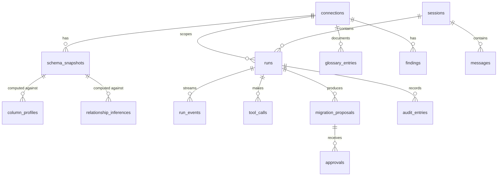

# Data model and API

## App database

The app database stays SQLite for the local-first build, extending the existing
`sessions` and `messages` tables in `services/session_store.py`. All tables
carry a `workspace_id` (a constant for local use) so a team server can move to
Postgres without reshaping data (D1).

Identifiers are text IDs with a prefix (`conn_`, `snap_`, `run_`) for
readability in logs. Timestamps are ISO 8601 UTC text, as in the current store.



### Tables

**connections**

| Column | Type | Notes |
| --- | --- | --- |
| id | text PK | `conn_…` |
| workspace_id | text | |
| name | text | Display name |
| engine | text | `postgresql`, `sqlite`, `duckdb`, `mysql` |
| tier | text | `sandbox`, `dev`, `prod` |
| dsn_template | text | Host, port, and database without the secret, e.g. `postgresql://reader@db.internal:5432/orders` |
| secret_ref | text | Keychain reference, never the secret |
| options_json | text | SSH tunnel, TLS, timeouts |
| privilege_grade | text | `A`, `B`, `C` from the connection test |
| cloud_models_allowed | integer | 0/1 |
| masking_enabled | integer | Locked to 1 outside Sandbox |
| created_at, updated_at | text | |

**schema_snapshots**

| Column | Type | Notes |
| --- | --- | --- |
| id | text PK | `snap_…` |
| connection_id | text FK | |
| content_hash | text | SHA-256 of the normalized JSON |
| server_version | text | |
| structure_json | text | Normalized structure (compressed if large) |
| table_count, column_count | integer | |
| created_at | text | |
| source | text | `connect`, `refresh`, `post_migration`, `shadow` |

**column_profiles** — one row per (snapshot, table, column); `stats_json`
holds null rate, distinct count, top-k (masked), pattern classes, histogram,
and PII class with confidence; `sample_fraction`, `exact` (0/1), `computed_at`.

**relationship_inferences** — child and parent columns, `score`, the component
scores (`containment`, `name_score`, `type_score`, `cardinality`), the
evidence query, and `status` (`proposed`, `confirmed`, `rejected`).

**glossary_entries** — `target_kind` (table, column, relationship), `target`
(qualified name), `kind` (description, enum_map, join_rule, filter_rule,
caveat, synonym), `body`, `status` (suggested, confirmed, rejected,
needs_review), `author_kind` (user, agent), `author_ref`, `snapshot_id`,
`evidence_json`.

**findings** — `kind`, `severity`, `target`, `summary`, `evidence_json`,
`fix_json`, `status` (open, accepted, dismissed, snoozed), `dismiss_reason`,
and `fingerprint` (a stable hash so a re-run does not duplicate a dismissed
finding).

**runs** — `session_id`, `connection_id`, `mode`, `effort`, `tier_at_start`,
`models_json` (role → model and provider), `budget_json`, `usage_json`,
`status` (running, awaiting_approval, completed, failed, cancelled,
interrupted), `stop_reason`, `prompt_version`, timestamps.

**run_events** — `run_id`, `seq` (monotonic per run), `type`, `payload_json`.
Stored so a reconnecting client can replay from `Last-Event-ID`. Pruned after
30 days, except the events that the messages reference.

**tool_calls** — `run_id`, `tool`, `args_json`, `status`, `result_summary`,
`rows_read`, `bytes_to_model`, `duration_ms`.

**migration_proposals** — `run_id`, `connection_id`, `goal`, `up_sql`,
`down_sql`, `base_snapshot_id`, `lint_json`, `impact_json`, `shadow_json`,
`status` (draft, verified, verified_with_warnings, failed, approved, applied,
exported, rejected, superseded).

**approvals** — `proposal_id`, `decision` (approved, rejected,
changes_requested), `approver`, `typed_confirmation`, `comment`, `decided_at`.

**audit_entries** — `seq`, `prev_hash`, `hash`, `workspace_id`,
`connection_id`, `run_id`, `actor`, `action`, `detail_json` (SQL after
rewriting, row counts, no result data), `created_at`.

**messages** (existing) gains `run_id` and `evidence_json`, replacing the
document-specific `sources` field with a general evidence list. Old messages
keep working: a document source is a kind of evidence.

**LangGraph checkpoints** live in their own tables, managed by
`langgraph-checkpoint-sqlite`, keyed by `run_id` as the thread ID.

## REST API

All routes are under `/api/v2` so the current `/api` routes keep working during
the migration. Request and response bodies are Pydantic models, as today.

### Connections

| Method | Path | Purpose |
| --- | --- | --- |
| GET | `/connections` | List (no secrets) |
| POST | `/connections` | Create; body includes the secret, which goes straight to the keychain |
| POST | `/connections/test` | Test without saving; returns version, grade, extensions, shadow availability |
| PATCH | `/connections/{id}` | Update; lowering the tier requires `reauth_secret` |
| DELETE | `/connections/{id}` | Delete, and remove the keychain entry |

### Catalog

| Method | Path | Purpose |
| --- | --- | --- |
| POST | `/connections/{id}/snapshots` | Refresh structure (starts a run; returns `run_id`) |
| GET | `/connections/{id}/snapshots` | List snapshots |
| GET | `/snapshots/{id}` | Full structure |
| GET | `/snapshots/{a}/diff/{b}` | Structural diff |
| GET | `/connections/{id}/tables?query=&schema=&limit=` | Search tables (catalog + glossary) |
| GET | `/connections/{id}/tables/{qualified_name}` | Detail: columns, keys, indexes, latest profile, glossary, dependents |
| GET | `/connections/{id}/graph?focus=&depth=&include_inferred=` | Nodes and edges for the ERD |

### Profiling, findings, relationships, glossary

| Method | Path | Purpose |
| --- | --- | --- |
| POST | `/connections/{id}/profiles` | Start profiling `{tables, sample}` (run) |
| GET | `/connections/{id}/findings?status=&kind=` | Findings inbox |
| PATCH | `/findings/{id}` | Accept, dismiss, or snooze |
| POST | `/relationships/{id}/confirm` · `/reject` | Decide on an inferred FK |
| GET/POST/PATCH | `/connections/{id}/glossary` | Glossary CRUD |

### Queries

| Method | Path | Purpose |
| --- | --- | --- |
| POST | `/connections/{id}/sql/check` | Guard + EXPLAIN; returns normalized SQL, plan, warnings, `query_token` |
| POST | `/connections/{id}/sql/run` | Run a `query_token`; returns the first page and a cursor |
| GET | `/queries/{cursor}/page/{n}` | Next page |
| POST | `/queries/{id}/cancel` | Cancel a running query |

The editor and the agent use the same check and run endpoints, so there is
exactly one path to the database.

### Runs and approvals

| Method | Path | Purpose |
| --- | --- | --- |
| POST | `/runs` | Start `{session_id, connection_id, mode, effort, message}` → `run_id` |
| GET | `/runs/{id}/events` | SSE stream; supports `Last-Event-ID` |
| POST | `/runs/{id}/cancel` | Cancel |
| GET | `/runs/{id}` | Status, usage, tool calls |
| GET | `/proposals/{id}` | Migration proposal with lint, impact, and shadow results |
| POST | `/proposals/{id}/decision` | `{decision, typed_confirmation, comment}` |
| POST | `/proposals/{id}/apply` | Apply an approved proposal (Sandbox/Dev only) |
| GET | `/proposals/{id}/export?format=alembic|flyway|sql|dbt` | Download |

### Seeds, exports, audit

| Method | Path | Purpose |
| --- | --- | --- |
| POST | `/connections/{id}/seed-plans` | Create a plan (run) |
| PATCH | `/seed-plans/{id}` | Edit generators |
| POST | `/seed-plans/{id}/generate` | `{target}` |
| GET | `/connections/{id}/export/docs?format=markdown|dbt_sources|json` | Data dictionary |
| GET | `/connections/{id}/audit?run_id=&since=` | Audit log; `.jsonl` export |

Errors use one shape: `{"error": {"code": "permission_denied", "message": "...", "retryable": false}}`.
Codes are stable; messages are sanitized (04).

## SSE event protocol

The current stream sends untyped objects (`{"token": ...}`, `{"done": true, "sources": [...]}`).
The Studio uses named SSE events with an ID, so the browser can resume a
stream and route each event to the right UI component.

```text
id: 42
event: tool.result
data: {"run_id":"run_7Q","step":3,"tool":"profile_table","status":"ok","summary":"...","evidence_ids":["ev_9"],"duration_ms":2310}
```

| Event | Payload highlights | UI effect |
| --- | --- | --- |
| `run.started` | mode, models, budget | Show the budget meter |
| `plan.updated` | checklist items with status | Render or tick the checklist |
| `step.started` | step number, node (`model`, `tools`) | Spinner on the current step |
| `tool.called` | tool, args (sanitized) | Collapsed tool line |
| `tool.result` | status, summary, evidence IDs, duration, rows read | Expand line; update budget |
| `evidence.added` | id, kind (query, profile, plan, sample, diff), title, body | Evidence card |
| `token` | text delta | Stream the answer |
| `sql.suggested` | sql, query_token, plan summary | Offer in the Query tab |
| `finding.added` | finding | Increment the Findings badge |
| `approval.required` | proposal ID, summary | Inline prompt linking to Changes |
| `budget.updated` | used vs. limit per resource | Budget meter |
| `run.completed` | final message ID, usage | Close the stream |
| `run.failed` | stop reason, sanitized message | Error state with a retry option |
| `heartbeat` | — | Every 15 s, keeps proxies from closing the stream |

Rules:

- **IDs are per run and monotonic.** Events are written to `run_events` before
  being sent, so replay after a reconnect is exact.
- **Payloads are bounded.** Large objects (a full plan, a result grid) are
  sent as references and fetched over REST.
- **Unknown event types are ignored by the client**, so the server can add
  events without breaking older frontends.
- **The stream is not the source of truth.** A client can reload a run's state
  from `GET /runs/{id}` at any time.

## Migrating from today's API

1. Add `/api/v2` alongside the current routes. The current UI keeps working.
2. Add the new tables with a small migration runner (versioned SQL files in
   `services/migrations/`). The current store uses `CREATE TABLE IF NOT
   EXISTS`, which cannot evolve existing tables.
3. Point the new frontend at `/api/v2`.
4. Retire the document routes, or keep document Q&A as a separate mode, once
   the Studio replaces it (an open product question).
