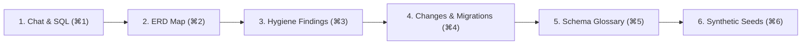

# 01. Getting Started with Autonomous Data & Schema Studio

Dimension is an autonomous data and schema intelligence studio. It functions as an interactive database workbench with an embedded data engineering agent that maps schemas, profiles column hygiene, runs safe natural language queries, tests migrations on disposable scratch databases, and generates synthetic test data.

---

## 1. Studio Architecture & 6 Workbench Views

The Studio is organized around 6 primary views, accessible via header navigation tabs or global keyboard shortcuts:



| View | Shortcut | Purpose | Key Capabilities |
| :--- | :--- | :--- | :--- |
| **`[Chat]`** | `⌘1` | Conversational SQL Assistant | Natural language querying, AST safety filtering, `EXPLAIN` cost guard, automatic `LIMIT` rewrites, 1-click execution cards, and real-time data grid rendering. |
| **`[Map]`** | `⌘2` | Interactive Schema Cartography | ERD canvas displaying table nodes, solid declared foreign keys, dashed inferred relationships ($\ge 0.85$ score), and point-in-time schema diffing. |
| **`[Findings]`** | `⌘3` | Data Hygiene Inbox | Triage orphaned rows, sentinel values (`'000-00-0000'`), format skew, unindexed foreign keys, and PII exposure using keyboard shortcuts (`J`/`K`/`A`/`D`). |
| **`[Changes]`** | `⌘4` | Shadow Migration Workbench | Verify DDL before writing. Lock-risk linter, dependency impact checks, two-way rollback tests on disposable scratch databases, and Decision D5 production export guardrails. |
| **`[Glossary]`** | `⌘5` | Semantic Schema Memory | Business term definitions, enum mappings, join conventions, and caveat rules that automatically inject into agent prompts. Export to dbt `sources.yml`. |
| **`[Seeds]`** | `⌘6` | Synthetic Data Synthesizer | Kahn's DAG topological dependency sorting, 3-pass cycle resolution, statistical distribution preservation, and Faker PII replacement ensuring 0% foreign key violations. |

---

## 2. Quickstart & Installation

### System Requirements
- **Python**: 3.9, 3.10, 3.11, or 3.12
- **Supported Databases**: PostgreSQL, MySQL, SQLite, and DuckDB
- **Local Model Runner (Optional)**: Ollama (`qwen3:4b`, `qwen2.5-coder`, or `llama3`)

### Installation Steps

```bash
# 1. Clone the repository
git clone https://github.com/aagamshah15/agentic-document-qa.git
cd agentic-document-qa

# 2. Create and activate a Python virtual environment
python3 -m venv venv
source venv/bin/activate

# 3. Install core dependencies
pip install -r requirements.txt

# 4. Launch the Dimension Studio server
uvicorn main:app --reload --port 8001
```

Once running, navigate to [http://localhost:8001](http://localhost:8001) in your browser.

---

## 3. Global Keyboard Shortcuts

Dimension provides a comprehensive set of keyboard shortcuts engineered for high-velocity engineering workflows:

| Shortcut | Scope | Action | Description |
| :--- | :--- | :--- | :--- |
| **`⌘1`** / `Ctrl+1` | Global | Switch to **`[Chat]`** | Opens the conversational guarded SQL interface. |
| **`⌘2`** / `Ctrl+2` | Global | Switch to **`[Map]`** | Opens the interactive ERD schema canvas. |
| **`⌘3`** / `Ctrl+3` | Global | Switch to **`[Findings]`** | Opens the data hygiene and quality triage inbox. |
| **`⌘4`** / `Ctrl+4` | Global | Switch to **`[Changes]`** | Opens the shadow migration and DDL workbench. |
| **`⌘5`** / `Ctrl+5` | Global | Switch to **`[Glossary]`** | Opens semantic schema memory and dbt exports. |
| **`⌘6`** / `Ctrl+6` | Global | Switch to **`[Seeds]`** | Opens Kahn's DAG synthetic data generator. |
| **`⌘B`** / `Ctrl+B` | Global | Toggle Sidebar | Expands or collapses the left navigation panel. |
| **`⌘K`** / `Ctrl+K` | Global | New Session | Starts a fresh conversational agent thread. |
| **`⌘+Shift+F`** | Global | Focus Mode | Toggles full-width canvas view for deep data inspection. |
| **`Esc`** | Global | Dismiss / Cancel | Closes open modals or halts active agent streaming. |
| **`J`** | Findings View | Next Finding | Moves selection cursor down to the next finding card. |
| **`K`** | Findings View | Previous Finding | Moves selection cursor up to the previous finding card. |
| **`A`** | Findings View | Accept Finding | Converts finding into a migration or glossary rule. |
| **`D`** | Findings View | Dismiss Finding | Dismisses finding and stores decision in connection memory. |

---

## 4. Evaluation Fixtures & Pre-Bundled Datasets

Dimension comes pre-packaged with sample databases in `data/sample_datasets/` designed to demonstrate each capability:

- **`ecommerce.sqlite`**: Relational retail schema (`customers`, `orders`, `order_items`, `products`) with primary keys and foreign keys for multi-table analytics and seed generation.
- **`shop_messy.db`**: Benchmark evaluation database containing 15 planted traps (undeclared foreign keys, containment traps, mixed date formats, sentinel values, and prompt injections).
- **`wide_schema.db`**: Scalability benchmark database containing 1,200 tables across 30 domain namespaces for sub-second metadata retrieval testing.

Run the evaluation harness to verify studio intelligence:
```bash
python experiments/evaluate_studio.py
```

---

## Next Steps

- Proceed to **[02. Connecting Databases & Environment Tiers](file:///Users/aagam/Agentic%20Q%26A/docs/user/02-connecting-databases.md)** to configure your first database connection.
- Explore the **[Full User Guide](file:///Users/aagam/Agentic%20Q%26A/docs/USER_GUIDE.md)** for in-depth UI breakdowns.
- Review the **[API Reference](file:///Users/aagam/Agentic%20Q%26A/docs/API_REFERENCE.md)** for programmatic integration.
