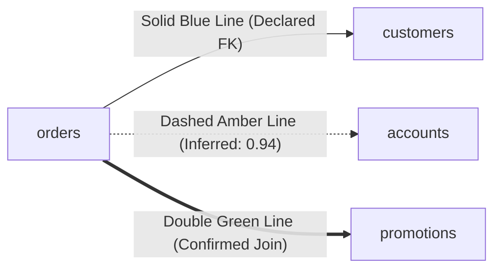

# 03. Schema Cartography & ERD Navigation

The **Map View** (`⌘2`) provides an interactive Entity-Relationship Diagram (ERD) canvas visualizing table structures, declared constraints, and inferred foreign keys across your database.

---

## 1. Navigating the ERD Canvas

The canvas renders interactive table cards with pan and zoom capabilities:
- **Pan**: Click and drag on empty canvas background.
- **Zoom**: Use scroll wheel or zoom controls in the corner.
- **Node Selection**: Click any table card to highlight all connected incoming and outgoing foreign key edges.
- **Search Tables**: Use the filter box in the upper bar to quickly find and center a specific table across large schemas (supporting 1,000+ tables).

---

## 2. Declared vs. Inferred Relationships

Dimension visually distinguishes between database-enforced foreign keys and machine-inferred semantic relationships:

| Visual Style | Relationship Type | Meaning & Action |
| :--- | :--- | :--- |
| **Solid Blue Edge** | **Declared Foreign Key** | Defined in the database DDL. Verified constraint with primary key target. |
| **Dashed Amber Edge** | **Inferred Foreign Key** | Discovered by the inference engine via containment analysis ($\ge 0.85$ confidence). Click the edge to view match score and confirm or dismiss. |
| **Confirmed Green Edge** | **Confirmed Semantic Join** | User-approved relationship. Permanently stored in the schema memory glossary and used in subsequent NL→SQL join paths. |

### Inference Scoring Heuristic

Candidate relationships between unconstrained columns are scored via a multi-factor formula:

$$\text{Score} = 0.50 \times \text{Containment} + 0.25 \times \text{NameSimilarity} + 0.15 \times \text{TypeCompatibility} + 0.10 \times \text{CardinalityFit}$$

The engine automatically suppresses common false-positive traps:
1. **Lookup Table Trap**: Low-cardinality integer codes (`1..7`) matching unrelated state/region IDs.
2. **Shared Sequence Trap**: Unrelated auto-incrementing surrogate primary keys (`1, 2, 3...`) across tables.

---

## 3. Schema Snapshots & Drift Diffing

Every time a connection is inspected, Dimension records an immutable schema snapshot with a canonical SHA-256 content hash.

### Detecting Schema Drift

- **Snapshot History**: Click **"Snapshots"** to view all recorded structural states over time.
- **Point-in-Time Diff**: Compare any two snapshots (`GET /api/v2/snapshots/{id_a}/diff/{id_b}`) to see:
  - Added tables
  - Dropped tables
  - Altered columns (type changes, nullability shifts)
  - Added or removed constraints
- **Cross-Connection Drift**: Compare staging against production (`GET /api/v2/connections/{conn_a}/diff/{conn_b}`) to verify that migrations landed identically before promoting code.

---

## 4. Cartography & Graph APIs

- `GET /api/v2/connections/{conn_id}/graph`: Returns graph structure with nodes, columns, declared edges, and inferred edges.
- `POST /api/v2/connections/{conn_id}/relationships/infer`: Triggers containment analysis to uncover undeclared foreign keys.
- `POST /api/v2/relationships/{rel_id}/confirm`: Promotes an inferred relationship to confirmed status.
- `POST /api/v2/relationships/{rel_id}/reject`: Dismisses an inferred relationship.
- `GET /api/v2/connections/{conn_id}/diff`: Diffs the latest recorded snapshot against live database schema.

---

## Navigation

- **Previous**: [02. Connecting Databases & Environment Tiers](file:///Users/aagam/Agentic%20Q%26A/docs/user/02-connecting-databases.md)
- **Next**: [04. Data Hygiene & Findings Inbox](file:///Users/aagam/Agentic%20Q%26A/docs/user/04-hygiene-and-findings.md)
