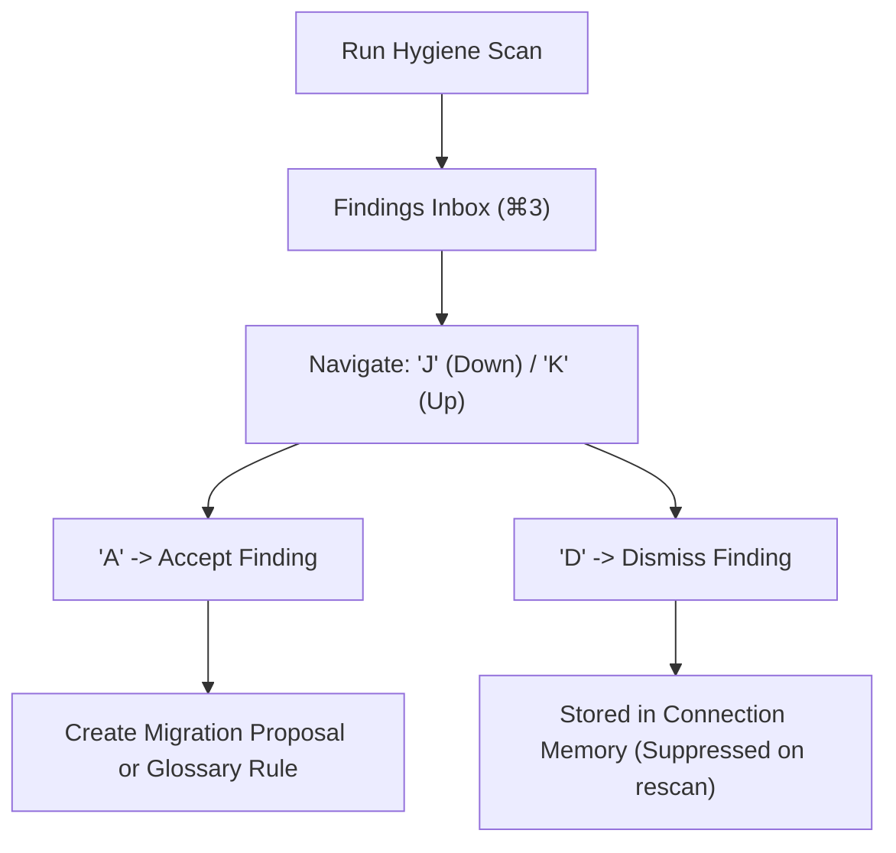

# 04. Data Hygiene & Findings Inbox

The **Findings View** (`⌘3`) provides an automated data quality and schema hygiene inbox. Dimension systematically scans your connected database for anomalies that break downstream analytics, silently degrade query performance, or expose sensitive personal data.

---

## 1. Automated Hygiene Scans

Dimension's deep profiler checks for five major classes of hygiene issues:

| Category | Icon | What is Detected | Example Finding |
| :--- | :--- | :--- | :--- |
| **Orphan Rows** | ⚠️ | Child foreign keys referencing non-existent parent primary keys. | `0.7% orders.customer_id reference non-existent customers.id` |
| **Sentinel Values** | 🚫 | Magic strings or placeholder numbers masking missing data. | `'000-00-0000'`, `'1900-01-01'`, `999999` in `phone` or `dob` |
| **Format Skew** | 🔄 | Multiple incompatible timestamp or string formats in a single column. | Mixed ISO `2024-01-15` and US `01/15/2024` in string date columns |
| **PII Exposure** | 🔒 | Unmasked personal data detected in non-compliant columns. | Unencrypted emails, phone numbers, SSNs, or credit card numbers |
| **Missing Indexes** | ⚡ | High-cardinality foreign keys lacking database index support. | `orders(customer_id)` missing index, causing sequential scans on joins |

Each finding is assigned a stable SHA-256 fingerprint computed from `hash(table, column, rule_name)` so triage decisions persist across recurring scans.

---

## 2. Keyboard-Driven Triage Workflow (J/K/A/D)

Engineers can rapidly triage findings using keyboard-driven controls inspired by Superhuman:

| Shortcut | Action | Description |
| :--- | :--- | :--- |
| **`J`** | **Next Finding** | Moves active selection down to the next finding card. |
| **`K`** | **Previous Finding** | Moves active selection up to the previous finding card. |
| **`A`** | **Accept Finding** | Converts the finding into an actionable migration proposal or glossary business rule. |
| **`D`** | **Dismiss Finding** | Records the finding as dismissed in the connection's memory with an optional reason note. |

---

## 3. Findings Lifecycle & Remediation

When you accept a finding:
1. **Orphan Rows**: The studio offers to generate a cleanup script (`DELETE ... WHERE ... NOT IN`) or convert the constraint into a soft relationship.
2. **Missing Index**: One-click action prompts the **Changes Workbench** to draft an `ADD INDEX` migration with lock-risk validation.
3. **Sentinel Values**: Automatically registers an enum mapping or filter rule in the **Glossary** (e.g., `WHERE dob != '1900-01-01'`) so downstream NL→SQL queries automatically filter out sentinels.
4. **Dismissed Findings**: Stored in `dismissed_findings` in the app database. Recurring scans will not resurface dismissed findings unless the underlying condition changes significantly (e.g., orphan rate jumps from 0.1% to 15%).

---

## 4. Hygiene & Findings APIs

- `POST /api/v2/connections/{conn_id}/hygiene`: Triggers a deep hygiene scan across all tables.
- `GET /api/v2/connections/{conn_id}/findings`: Queries the findings inbox, with filters for `status` (`open`, `accepted`, `dismissed`) and `category`.
- `PATCH /api/v2/findings/{finding_id}`: Updates finding status (`{"status": "accepted"}` or `{"status": "dismissed", "dismiss_reason": "Known legacy data"}`).

---

## Navigation

- **Previous**: [03. Schema Cartography & ERD Navigation](file:///Users/aagam/Agentic%20Q%26A/docs/user/03-schema-cartography.md)
- **Next**: [05. Guarded Natural Language to SQL](file:///Users/aagam/Agentic%20Q%26A/docs/user/05-guarded-sql.md)
