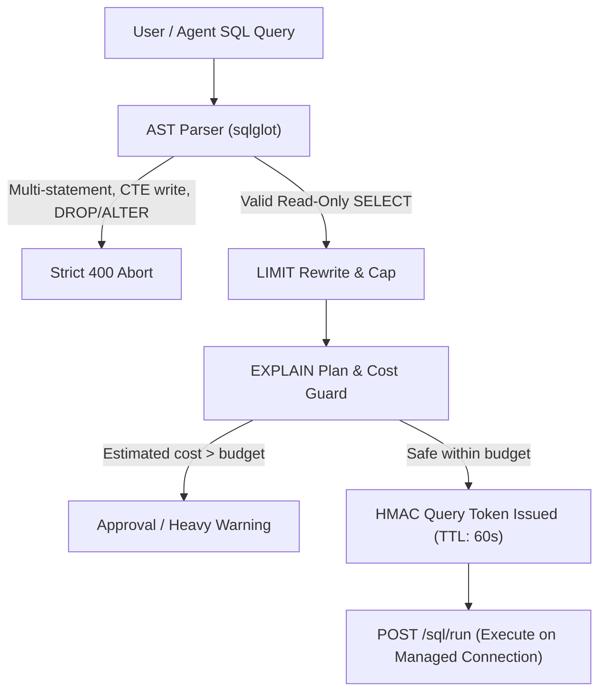

# 05. Guarded Natural Language to SQL & Cost Guard

The **Chat & SQL Workbench** (`⌘1`) enables engineers and analysts to ask questions in natural language and receive verified, dialect-tuned SQL queries executed through a multi-tier safety choke point.

---

## 1. Safety Choke Point & AST Analysis

Every SQL statement—whether generated by an LLM or typed by a user—passes through the AST SQL Guard powered by `sqlglot`:



### Safety Rules Enforced:
1. **Strict Read-Only Enforcement**: Rejects any statement containing `INSERT`, `UPDATE`, `DELETE`, `DROP`, `ALTER`, `CREATE`, `TRUNCATE`, `GRANT`, `REVOKE`, `COPY`, or `SELECT INTO`.
2. **CTE Injection Defense**: Analyzes Common Table Expressions (`WITH ... AS (...)`) to prevent masked DDL/DML execution (e.g., `WITH del AS (DELETE FROM orders RETURNING *) SELECT * FROM del;`).
3. **Multi-Statement Rejection**: Aborts queries containing semicolons followed by secondary commands.
4. **Mandatory Row Fetch Capping**:
   - Injects `LIMIT 500` by default if no `LIMIT` is specified.
   - Enforces a maximum cap of `10,000` rows for UI grid rendering.
   - Restricts LLM agent context retrieval to `50` rows.
5. **Cryptographic `query_token`**: Once validated, the engine generates an HMAC signature:
   $$\text{token} = \text{HMAC-SHA256}(\text{secret}, \text{query} \parallel \text{conn\_id} \parallel \text{timestamp})$$
   The execution runner (`POST /api/v2/connections/{conn_id}/sql/run`) strictly refuses to execute any query that lacks a valid token issued within the last 60 seconds.

---

## 2. EXPLAIN Cost Guard

Before dispatching queries to target databases, Dimension executes an `EXPLAIN (FORMAT JSON)` or dialect-equivalent query plan inspection:

- **Sequential Scan Threshold**: Flags sequential scans on tables exceeding tier thresholds (e.g., > 1,000,000 rows on dev, > 500,000 rows on prod).
- **Nested Loop Warnings**: Detects unindexed cartesian joins that would lock connection threads or saturate memory.
- **Estimated Row Cost**: Calculates total cost units against the connection budget. If estimated execution time exceeds 5 seconds, an interactive confirmation dialog appears before execution.

---

## 3. Schema Compression & Glossary Injection

To maintain sub-second response times and prevent token bloat, the agent compresses retrieved schemas into compact notation:

```text
orders(id PK int, cust int→customers.id [inferred .99], status int {1:new,4:refunded}) ~42M rows
```

When relevant business terms exist in the **Glossary**, they are automatically injected into the generation prompt:
- *Business Rule*: "Active customer means `status = 1 AND deleted_at IS NULL`"
- *Filter Rule*: "Exclude internal test orders (`WHERE is_test = 0`)"
- *Join Convention*: "`orders.customer_id` joins on `customers.id`"

---

## 4. Guarded SQL APIs

- `POST /api/v2/connections/{conn_id}/sql/check`: Validates SQL through AST guard, injects LIMIT, runs EXPLAIN cost inspection, and issues cryptographic `query_token`.
- `POST /api/v2/connections/{conn_id}/sql/run`: Executes pre-checked query using `query_token` against a read-only session with strict row fetch limits.

---

## Navigation

- **Previous**: [04. Data Hygiene & Findings Inbox](file:///Users/aagam/Agentic%20Q%26A/docs/user/04-hygiene-and-findings.md)
- **Next**: [06. Shadow Migrations & Schema Changes](file:///Users/aagam/Agentic%20Q%26A/docs/user/06-shadow-migrations.md)
