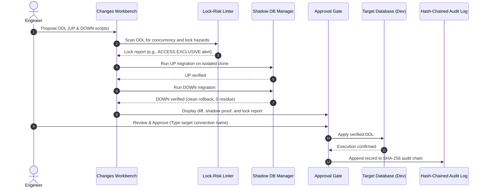

# 06. Shadow Migrations & Schema Changes

The **Changes View** (`⌘4`) provides a verify-before-write migration pipeline. Dimension tests DDL scripts on isolated shadow databases, scans for database lock hazards, checks view dependencies, and requires explicit human approval before touching real environments.

---

## 1. Verify-Before-Write Pipeline



---

## 2. Lock-Risk & Impact Linter

The migration linter scans proposed DDL for hazardous lock patterns that would block production queries:

| Hazard Pattern | Severity | Risk | Safe Alternative Suggested |
| :--- | :--- | :--- | :--- |
| `CREATE INDEX ...` | Warning | Acquires `SHARE` lock; blocks concurrent table writes on Postgres. | `CREATE INDEX CONCURRENTLY ...` |
| `ALTER TABLE ADD COLUMN NOT NULL ...` | High | Rewrites entire table under `ACCESS EXCLUSIVE` lock without default or generated column. | Add nullable column first, backfill rows in batches, then set `NOT NULL`. |
| `ALTER TABLE ADD FOREIGN KEY ...` | Medium | Scans entire table under lock to validate constraints. | `ADD CONSTRAINT ... NOT VALID` followed by `VALIDATE CONSTRAINT`. |
| `DROP TABLE / COLUMN` | Critical | Permanently destroys data and breaks dependent views or triggers. | Check view dependencies via `pg_depend` before proceeding. |

---

## 3. Two-Way Shadow Verification

Before any schema change is approved, Dimension tests both forward execution and rollback on a disposable scratch instance:
1. **Isolated Shadow Clone**:
   - **SQLite**: Instant file copy to a temporary directory.
   - **DuckDB**: In-memory structural clone.
   - **PostgreSQL**: Local schema-only clone or staging scratch replica.
2. **Forward Test (`UP`)**: The engine applies the `UP` migration script and verifies that table and column structures match the expected state.
3. **Rollback Test (`DOWN`)**: The engine applies the `DOWN` migration script and verifies that the resulting schema is byte-for-byte identical to the original snapshot (zero residual tables, orphan sequences, or leftover constraints).

---

## 4. Production Safety Guardrail (Decision D5)

> [!IMPORTANT]
> **Production Write Block**:
> Dimension strictly enforces Decision D5: direct autonomous writes to `prod` connections are disabled.

When targeting a connection marked as `tier: prod`:
- The **"Apply"** button is permanently disabled in the UI.
- The studio provides one-click export into industry-standard migration tools:

### Alembic Migration Export Example
```python
"""add_loyalty_points_to_customers

Revision ID: 3a9f018e1b2c
Revises: 1f82c49e0a7b
Create Date: 2026-10-30 18:45:00
"""
from alembic import op
import sqlalchemy as sa

def upgrade():
    op.add_column('customers', sa.Column('loyalty_points', sa.Integer(), nullable=False, server_default='0'))
    op.create_index('ix_customers_loyalty_points', 'customers', ['loyalty_points'])

def downgrade():
    op.drop_index('ix_customers_loyalty_points', table_name='customers')
    op.drop_column('customers', 'loyalty_points')
```

### Flyway Migration Export Example
- Forward script (`V2__add_loyalty_points.sql`):
  ```sql
  ALTER TABLE customers ADD COLUMN loyalty_points INTEGER DEFAULT 0 NOT NULL;
  CREATE INDEX ix_customers_loyalty_points ON customers (loyalty_points);
  ```
- Rollback script (`U2__add_loyalty_points.sql`):
  ```sql
  DROP INDEX IF EXISTS ix_customers_loyalty_points;
  ALTER TABLE customers DROP COLUMN IF EXISTS loyalty_points;
  ```

---

## 5. Shadow Migration APIs

- `POST /api/v2/proposals`: Submits a migration proposal; runs lock-risk linting and 2-way shadow DB verification.
- `GET /api/v2/connections/{conn_id}/proposals`: Lists all migration proposals for a connection.
- `GET /api/v2/proposals/{prop_id}`: Retrieves proposal details and shadow verification proof.
- `POST /api/v2/proposals/{prop_id}/decision`: Records user approval or rejection (`{"decision": "approved"}`).
- `POST /api/v2/proposals/{prop_id}/apply`: Applies approved proposal to `sandbox` or `dev` (strictly blocked on `prod`).
- `GET /api/v2/proposals/{prop_id}/export`: Exports migration in format `alembic`, `flyway`, or `sql`.

---

## Navigation

- **Previous**: [05. Guarded Natural Language to SQL](file:///Users/aagam/Agentic%20Q%26A/docs/user/05-guarded-sql.md)
- **Next**: [07. Synthetic Test Data & Seed Generation](file:///Users/aagam/Agentic%20Q%26A/docs/user/07-synthetic-seeds.md)
