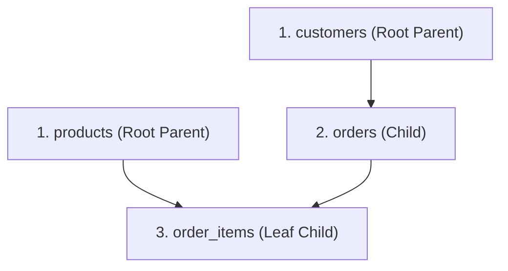

# 07. Synthetic Test Data & Seed Generation

The **Seeds View** (`⌘6`) provides an intelligent synthetic data synthesizer that generates realistic, distribution-preserving test data that strictly satisfies relational foreign key constraints without leaking sensitive customer information.

---

## 1. Topological Dependency Resolution (Kahn's DAG)

To prevent foreign key constraint violations during seeding, Dimension constructs a Directed Acyclic Graph (DAG) of your database schema and sorts tables topologically using Kahn's algorithm:



Parent tables are always populated first, ensuring valid primary key IDs are available when child tables reference foreign keys.

### Handling Self-Referencing and Circular Dependencies
When tables contain self-referencing foreign keys (e.g., `employees.manager_id -> employees.id`) or circular references:
1. **Pass 1**: Insert parent rows with the self-referencing column set to `NULL`.
2. **Pass 2**: Insert remaining child rows referencing existing parent IDs.
3. **Pass 3**: Backfill and update the self-referencing foreign keys to point to valid records within the generated batch.

---

## 2. Distribution-Preserving Generation

Rather than populating columns with random dummy text, Dimension leverages metadata from the statistical profiler:

| Column Type | Generation Strategy | Result |
| :--- | :--- | :--- |
| **Categorical Enums** | Profiled frequency sampling | Matches real-world distribution (e.g., 70% `standard`, 25% `express`, 5% `overnight`). |
| **Numeric & Dates** | Min/Max range and quantile interpolation | Generates values following observed real-world distributions. |
| **Foreign Keys** | Uniform random selection from generated parent IDs | Guarantees **0% foreign key constraint violations**. |
| **PII Columns** | Synthetic generation via Python `Faker` | Real customer names, emails, and phone numbers are never sampled or copied. |

---

## 3. Seed Plan Export Formats

Once a seed plan is configured (e.g., 1,000 orders with corresponding customers and items), you can choose your desired output target:

1. **Direct Insertion**: Injects records directly into a selected `sandbox` or `dev` connection inside a transaction.
2. **SQL `INSERT` Script**: Downloads an executable `.sql` script containing ordered insert statements.
3. **Parquet Files**: Generates columnar `.parquet` files organized per table, ideal for loading into data lakes or analytics engines (DuckDB, Snowflake, BigQuery).

### Example Output SQL Script
```sql
-- Topological Order: 1. customers, 2. products, 3. orders, 4. order_items
BEGIN TRANSACTION;
INSERT INTO customers (id, name, email, country, signup_date) VALUES 
  (101, 'Jordan Matthews', 'jordan.m101@example.net', 'Canada', '2024-03-12'),
  (102, 'Casey Rivera', 'casey.r102@example.org', 'United States', '2024-04-05');

INSERT INTO orders (id, customer_id, order_date, status, total_amount) VALUES 
  (501, 101, '2024-05-01', 'completed', 149.99),
  (502, 102, '2024-05-02', 'pending', 39.50);
COMMIT;
```

---

## 4. Synthetic Seed APIs

- `POST /api/v2/connections/{conn_id}/seed-plans`: Generates a topological DAG seed execution plan with row counts and dependency sequencing.
- `POST /api/v2/connections/{conn_id}/seed-plans/generate`: Executes seed plan to generate synthetic SQL statements or insert rows into target sandbox.

---

## Navigation

- **Previous**: [06. Shadow Migrations & Schema Changes](file:///Users/aagam/Agentic%20Q%26A/docs/user/06-shadow-migrations.md)
- **Next**: [08. Privacy, Security & Safety Architecture](file:///Users/aagam/Agentic%20Q%26A/docs/user/08-privacy-and-safety.md)
