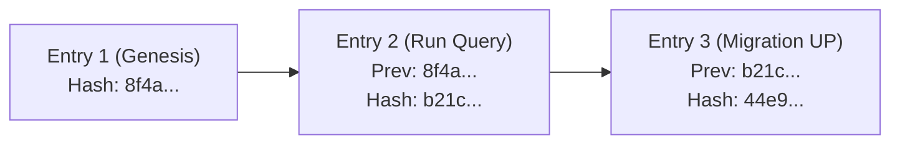

# 08. Privacy, Security & Safety Architecture

Dimension is engineered around a strict local-first, privacy-preserving security model. It guarantees that database credentials, customer rows, and unmasked personal data never leak to external third parties or cloud telemetry services.

---

## 1. Local-First Default Architecture

By default, Dimension runs entirely on your local workstation:
- **Local Language Models**: Runs via Ollama (`qwen3:4b`, `qwen2.5-coder`, `llama3`). No query text or schema metadata leaves your device.
- **Zero Cloud Telemetry**: External telemetry flags (`LANGCHAIN_TRACING_V2 = "false"`) are hard-coded in configuration to prevent LangSmith or third-party log ingestion.
- **Local Application Database**: All metadata, snapshots, findings, and logs reside in an encrypted/local SQLite database at `data/studio_app.db`.

---

## 2. Operating System Credential Vault

Dimension never writes database passwords to disk or configuration files:
- When you connect a database, passwords are stored in your operating system's native keychain (`keyring` on macOS Keychain, Windows Credential Manager, or Linux Secret Service) under the `dimension_studio` namespace.
- The application database stores only an opaque, non-reversible secret reference key (e.g. `sec_7f9b1c0d`).
- Credentials are retrieved into memory only at the moment a database connection is opened.

---

## 3. PII Masking & Cloud Disclosure Guarantee

When cloud language models (e.g., OpenAI, Anthropic) are enabled for a connection:

> [!IMPORTANT]
> **Mandatory PII Lock**:
> When `cloud_models_allowed` is set to `True`, the PII masking engine is **permanently locked on** and cannot be toggled off.

### What Leaves the Machine vs. What Stays Local:

| Metadata Sent to Cloud Model | Data That NEVER Leaves Your Machine |
| :--- | :--- |
| Natural language question prompt | Raw customer data rows |
| Compact schema notation (table & column names) | Database passwords & keychain credentials |
| Masked statistical profiles (null rates, cardinalities) | Full database dumps |
| Confirmed business glossary definitions | Audit logs & cryptographic hash chains |

Engineers can audit the exact boundary of what leaves the machine at any time via:
`GET /api/v2/connections/{connection_id}/cloud-disclosure`

---

## 4. Cryptographic Hash-Chained Audit Trail

Every statement execution, migration proposal, and schema change is recorded in an append-only `audit_entries` table.

Each entry is cryptographically linked to the previous entry via SHA-256:

$$\text{Hash}_i = \text{SHA256}(\text{Hash}_{i-1} \parallel \text{Actor} \parallel \text{Action} \parallel \text{TargetConnection} \parallel \text{Timestamp})$$



### Verifying Audit Integrity
You can verify the tamper-proof audit chain at any time via:
`GET /api/v2/connections/{conn_id}/audit`

The endpoint returns:
```json
{
  "status": "success",
  "audit_chain_valid": true,
  "verification_message": "Chain verified intact across 142 entries.",
  "entries": [...]
}
```

If an adversary alters, deletes, or inserts an entry out of order, the chain verification immediately reports the exact sequence ID where the cryptographic hash broke.

---

## Navigation

- **Previous**: [07. Synthetic Test Data & Seed Generation](file:///Users/aagam/Agentic%20Q%26A/docs/user/07-synthetic-seeds.md)
- **Home**: [01. Getting Started](file:///Users/aagam/Agentic%20Q%26A/docs/user/01-getting-started.md)
- **Comprehensive User Guide**: [User Guide](file:///Users/aagam/Agentic%20Q%26A/docs/USER_GUIDE.md)
